# Intelligent Agents

## What is an Agent?

An AI Agent is `an autonomous software system that can perceive its environment, make plans, and execute multi-step actions to achieve a specific goal`

Unlike a standard chatbot that only replies with text, an AI agent takes real-world actions like running code, calling software application programming interfaces (APIs), or browsing the web. [1] (https://www.youtube.com/shorts/EtfauX_axA4), [2] (https://www.youtube.com/watch?v=ZvDkJsKE80k&t=13)

 

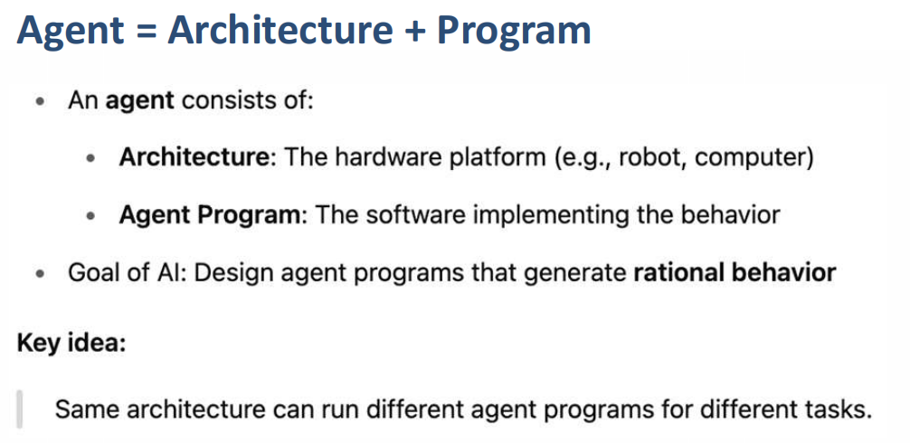
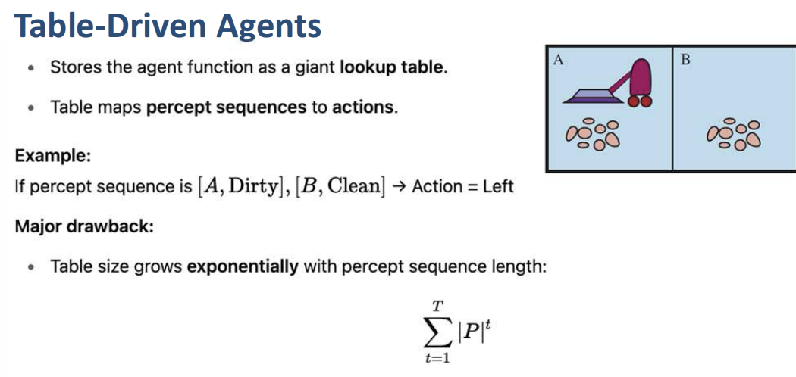

 

## Agent Types

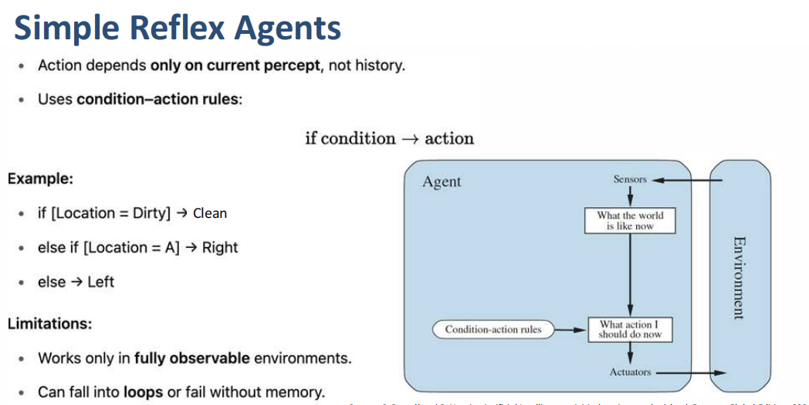
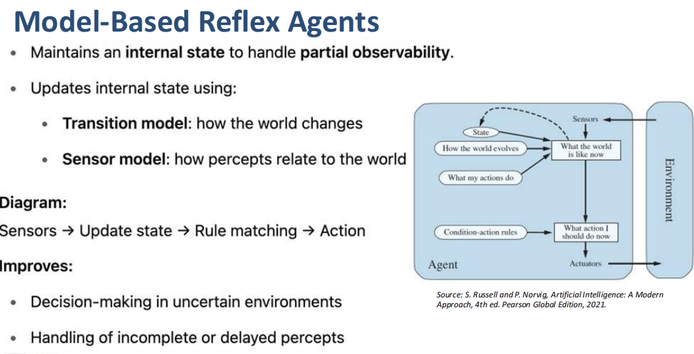
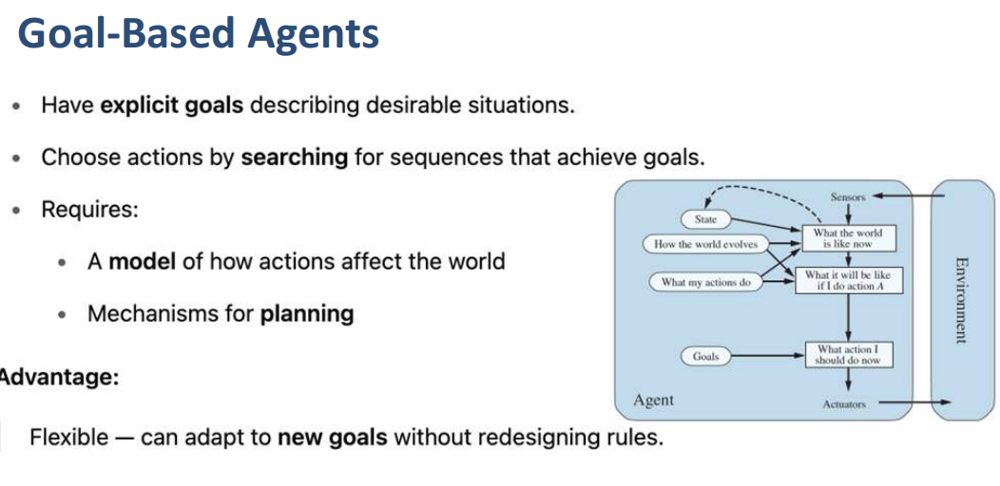
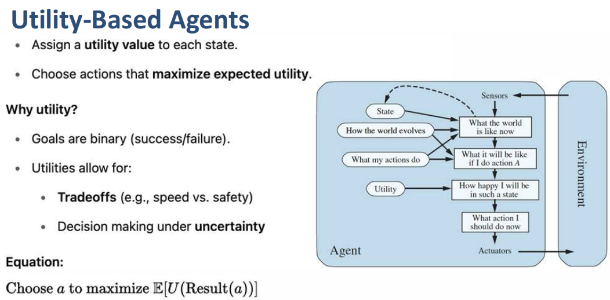

 

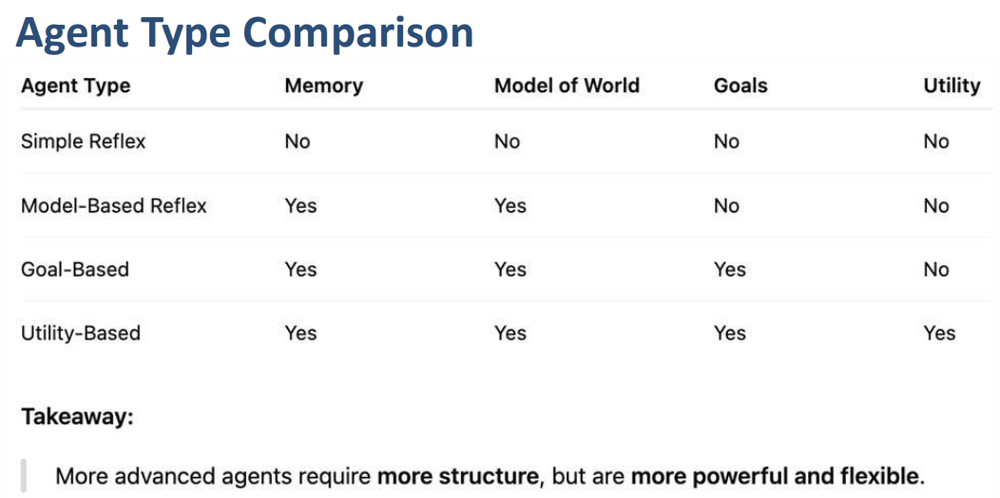

 

## Learning Agent

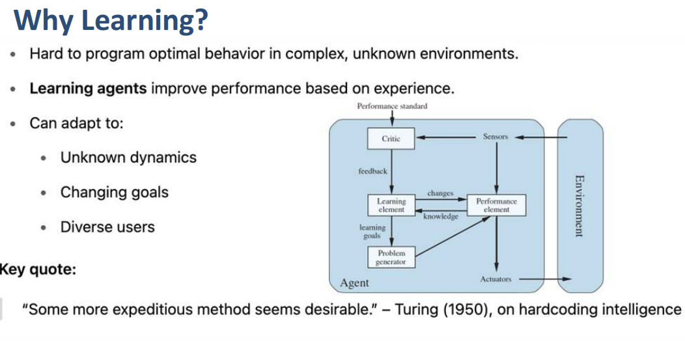
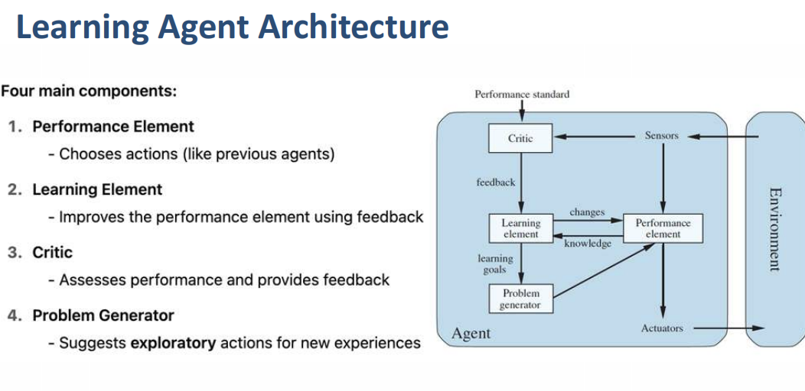
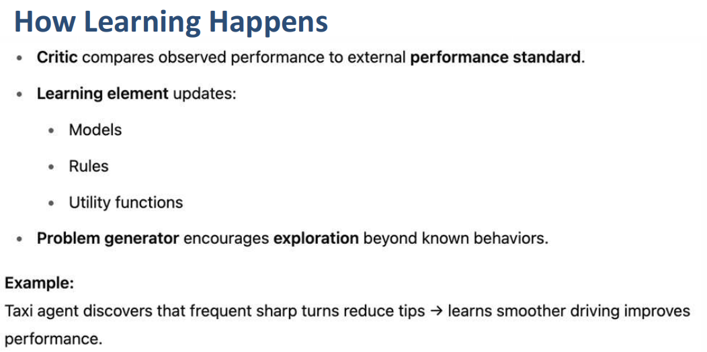
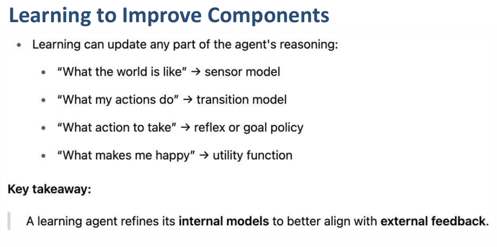

 

## Exploration & Exploitation

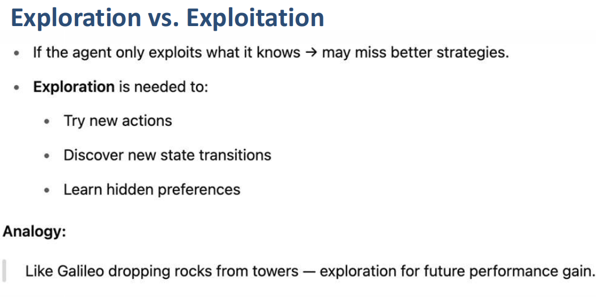
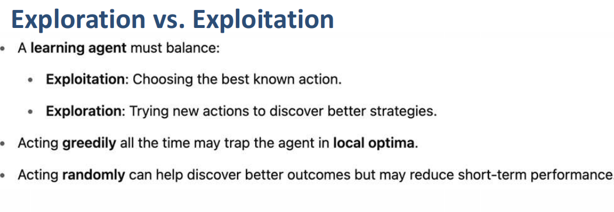
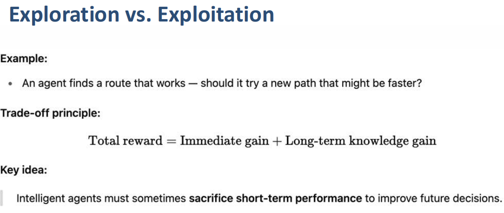

 

## Agent Representation

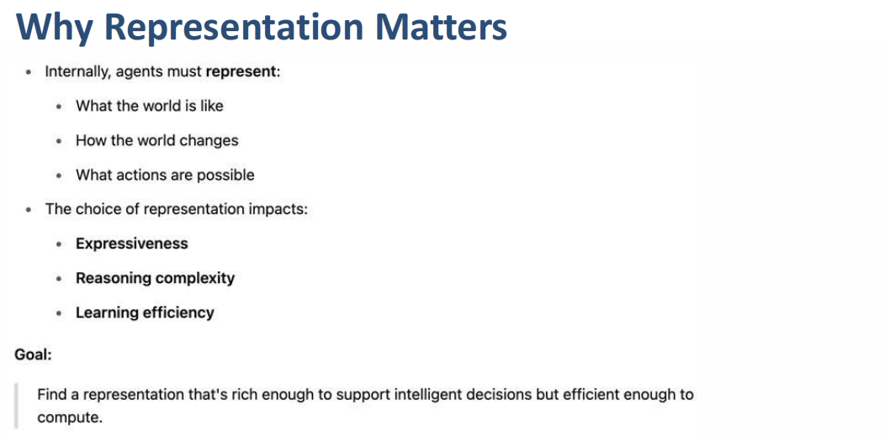
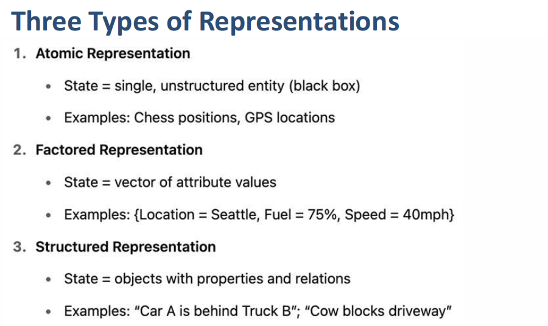
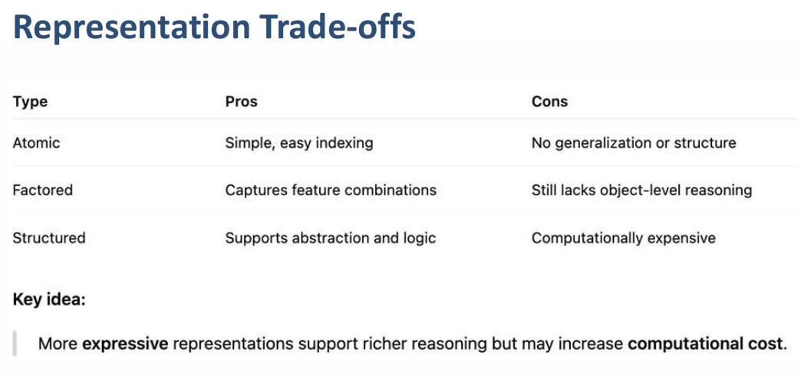

 

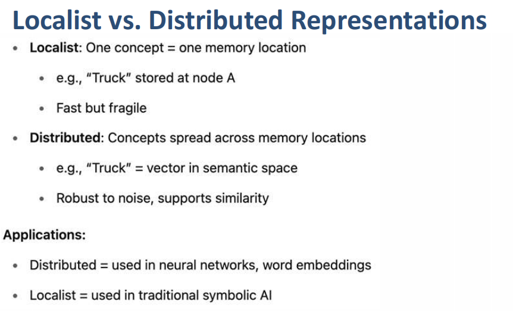

 

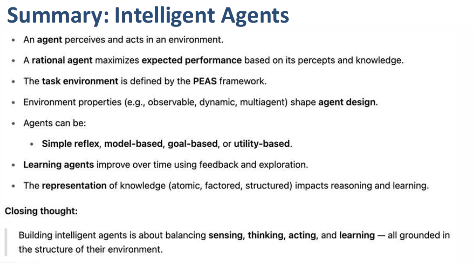

 

## Logical Agents

[View Logical Agent Doc](./logical-agents.md)
