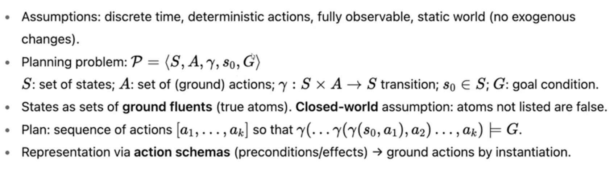
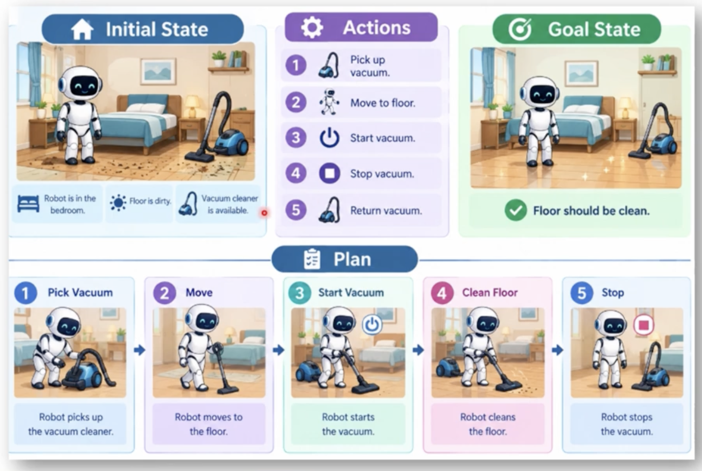
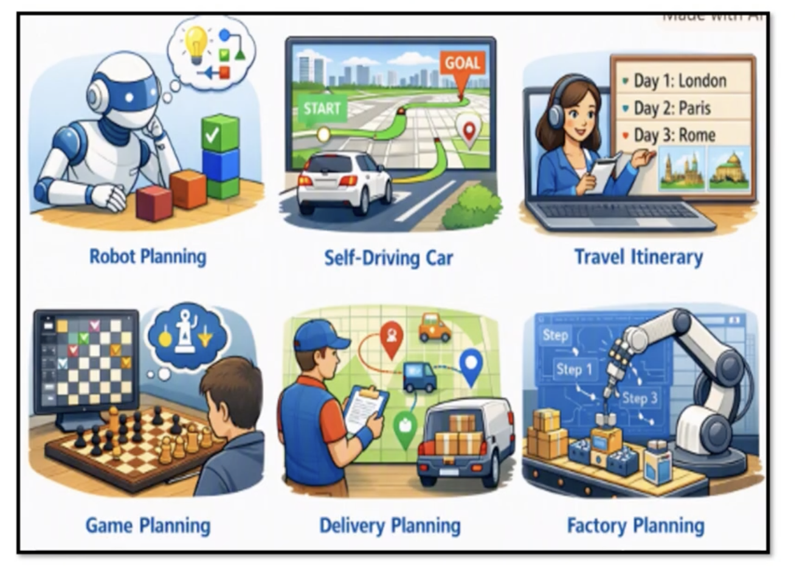

# Classical Planning Techniques

- Process of finding a sequence of actions that an intelligent agent should perform to achieve a desired goal from a given initial state.

```
Planning = Deciding "What actions should I take, and in what order, to reach my goal?"
```

<br/>
<br/>



A classical planning problem is formally defined as a 5-tuple:

$$\mathcal{P} = \langle S, A, \gamma, s_0, G \rangle$$

$S$ (Set of states): All possible configurations the world can be in.

$A$ (Set of actions): All available, fully specified (ground) actions the agent can choose from.

$\gamma: S \times A \to S$ (Transition function): A function that takes the current state and an action, and returns the resulting successor state.

$s_0 \in S$ (Initial state): The starting point or initial configuration of the world.

$G$ (Goal condition): A description of the target state(s) the agent wants to achieve.

<br/>

## Components



<br/>

## Planning Types

- [Goal Stack Planning](./gsp.md)
- [Non Linear Planning](./nlp.md)
- [Hierarchical Planning](./hp.md)

<br/>

## Usages


