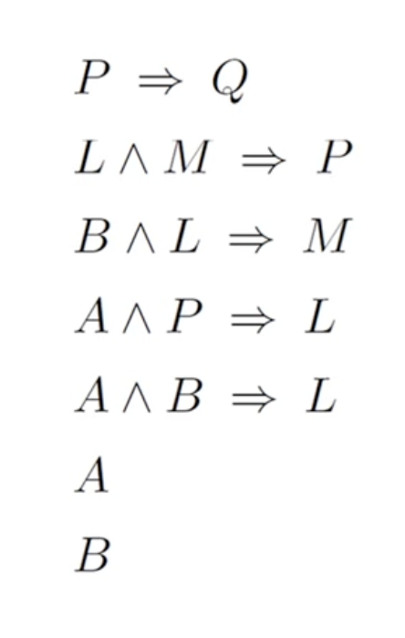
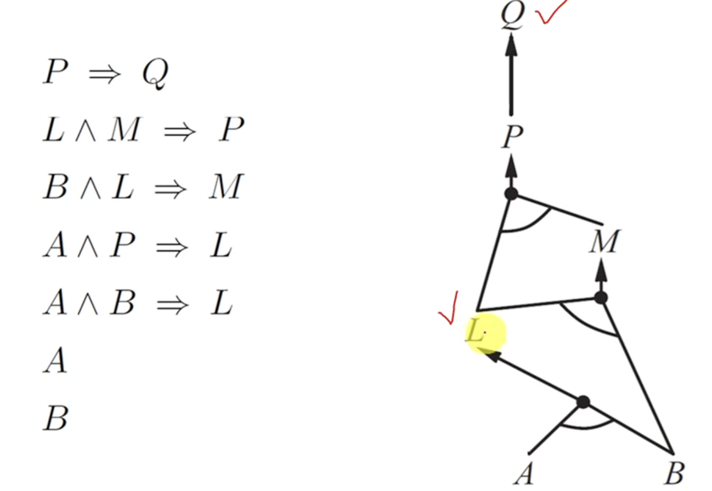
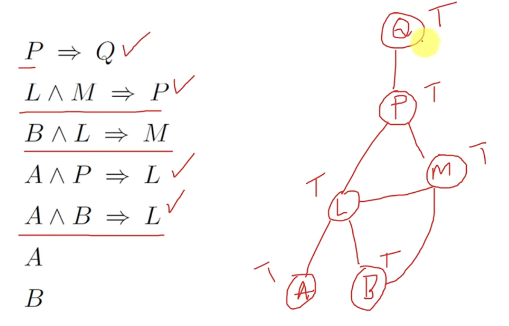

# First Order Logic

In prepositional logic has statements with operators. But for some keyworkds like `All`, `Every`, `Some` we uses `First Order Logic` syntax

To express,

- More infor about obejects
- Relationships between obejects

 

 

## Syntax

 

## Well Formed Formula

`First-Order Logic (FOL)` is the entire language system, while a `Well-Formed Formula (WFF)` is a single grammatically correct sentence written within that language.

You use the rules of `First-Order Logic` to build `Well-Formed Formulas`.

If a formula doesn't follow the rules of `FOL`, it is not `well-formed.`

 

## Translate Natural to FOL

 

## Examples

---

---

| Quantifier | English Keyword | Logical Connector | Why? |
| :--- | :--- | :--- | :--- |
| **$\forall$ (For all)** | "All", "Every", "Everyone" | **Implication ($\rightarrow$)** | Acts as a filter so you only evaluate the specific objects you care about (and ignore everything else in the universe). |
| **$\exists$ (There exists)** | "Some", "At least one" | **Conjunction ($\land$)** | Acts as a strict link demanding that a single object must satisfy both conditions at the exact same time. |

 

## WFF with Variable Types

| Variables | Logic Level | What It Tracks | Quick Analogy | English Example | First-Order Logic (FOL) Formula | Key Syntax Rule |
| :--- | :--- | :--- | :--- | :--- | :--- | :--- |
| **0 Variables** | Propositional | Whole, standalone facts with no internal subjects. | "The light is on." | "It is raining and the ground is wet." | \(R \land W\) | Uses simple uppercase letters; no quantifiers (\(\forall, \exists\)) allowed. |
| **1 Variable** | Basic Predicate | Traits or properties belonging to a single subject. | "Object \(x\) is a cat." | "Every student is smart." | \(\forall x (\text{Student}(x) \rightarrow \text{Smart}(x))\) | \(\forall\) pairs with an implication (\(\rightarrow\)); \(\exists\) pairs with a conjunction (\(\land\)). |
| **2 Variables** | Relational | A two-way interaction connecting a doer and a receiver. | "\(x\) chases \(y\)." | "Every student loves a movie." | \(\forall x (\text{Student}(x) \rightarrow \exists y (\text{Movie}(y) \land \text{Loves}(x,y)))\) | The outer quantifier always wraps entirely around the inner quantifier. |
| **3 Variables** | Advanced Relational | A three-way transaction linking a doer, an object, and a source/destination. | "\(x\) takes \(y\) from \(z\)." | "Every student emails a question to some professor." | \(\forall x (\text{Student}(x) \rightarrow \exists y (\text{Question}(y) \land \exists z (\text{Professor}(z) \land \text{Emails}(x,y,z))))\) | Build deep nesting by adding new \(\exists\) variables using the \(\land\) operator. |

 

## Form Types

**FOL (First-Order Logic):**

This is the raw language. It includes variables (x, y), predicates (P(x)), connectives (\(\land, \lor, \rightarrow\)), and quantifiers (∀, ∃). It can look messy, wild, and unstructured.

**The "NFs" (Normal Forms):**

These are standardized shapes. Just like you can rewrite the fraction \(\frac{4}{8}\) into its normal form \(\frac{1}{2}\), you rewrite an FOL formula into a specific "Normal Form" to make it easier for computers to solve.

 

| Form | Full Name | What it looks like | What it is used for |
| :--- | :--- | :--- | :--- |
| **PNF** | **Prenex** Normal Form | **All quantifiers (∀, ∃) are dragged to the very front** of the sentence. The rest of the sentence has no quantifiers. | **Step 1 in solving:** It cleans up the quantifiers so they aren't buried inside the logic. |
| **SNF** | **Skolem** Normal Form | Same as PNF, but **all existential quantifiers (∃) are eliminated** and replaced with constants or functions. Only ∀ remains. | **Step 2 in solving:** Computers hate ∃ because it means "searching" for an object. SNF removes that guesswork. |
| **CNF** | **Conjunctive** Normal Form | A giant chain of **ANDs** connecting brackets filled with **ORs**.  Example: `(A ∨ B) ∧ (¬C ∨ D)` | **Resolution Refutation:** This is the exact format AI and automated theorem provers need to prove a statement is true. |
| **DNF** | **Disjunctive** Normal Form | A giant chain of **ORs** connecting brackets filled with **ANDs**.  Example: `(A ∧ B) ∨ (¬C ∧ D)` | **Checking Satisfiability:** It is very easy for a human or computer to look at DNF and find a scenario where the formula becomes true. |

### Visualizing the Pipeline

Think of it as a factory assembly line. If you start with a messy, raw piece of FOL, you process it in this exact order to get it ready for an AI theorem prover:

Raw FOL ➔ **PNF** (Move quantifiers to front) ➔ **SNF** (Kill the ∃ symbols) ➔ **CNF** / **DNF** (Distribute ∨ over ∧)

*(Note: DNF is an alternative branch. You usually convert to **either** CNF or DNF at the end, rarely both, depending on what algorithmic tool you are using).*

 

## Resolution

Create the whole pipeline into a Graph called `Resolution`

 

## Forward and Backward Chaining

| Feature | Forward Chaining | Backward Chaining |
| :--- | :--- | :--- |
| **Approach** | Bottom-up (Data to Goal) | Top-down (Goal to Data) |
| **Strategy** | Data-driven | Goal-driven |
| **Starts with** | Known facts | The desired goal |
| **Action** | Derives all possible conclusions | Looks for supporting evidence |
| **Best used when** | You have lots of data but no clear single goal | You have a specific goal to prove/disprove |

 

Prove Q is true

 

**Forward Chaining**

 

**Backward Chaining**

