# First Order Logic

In prepositional logic has statements with operators. But for some keyworkds like `All`, `Every`, `Some` we uses `First Order Logic` syntax

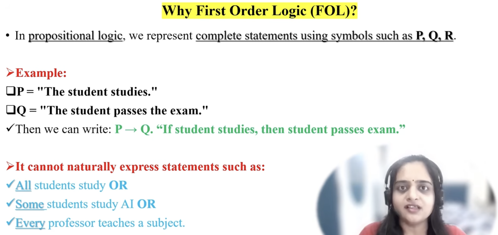

 

## Syntax

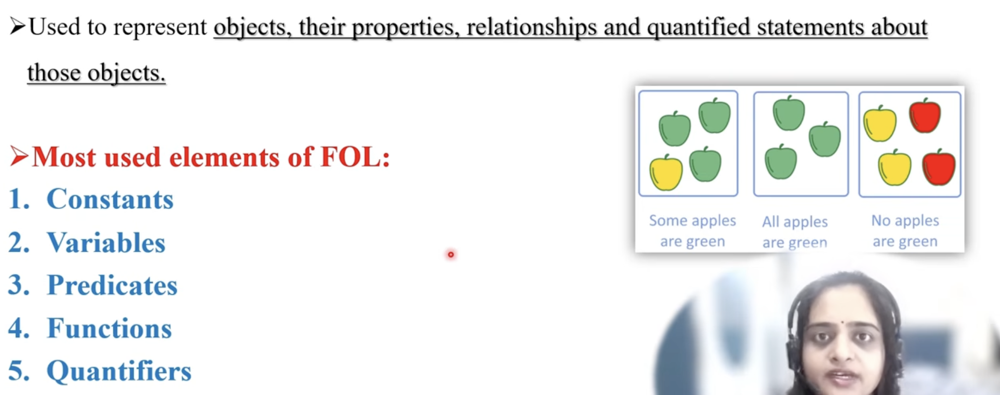

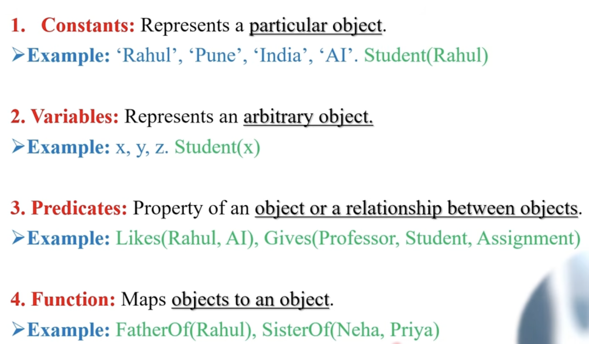

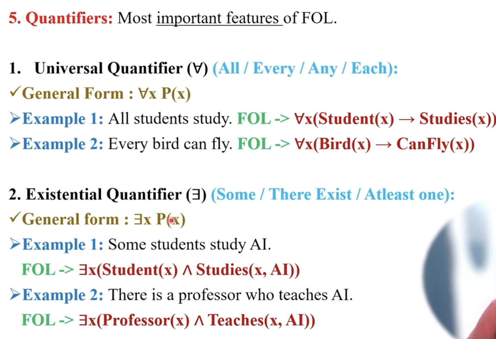

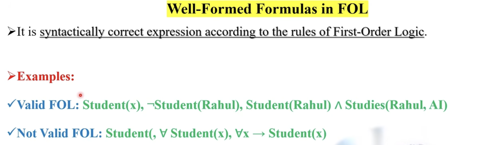

 

## Translate Natural to FOL

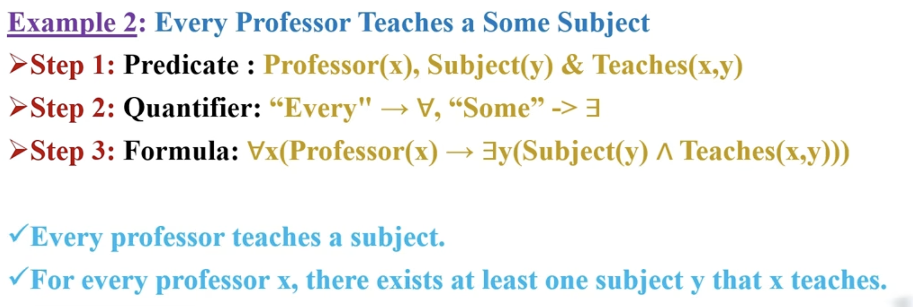

 

## Examples

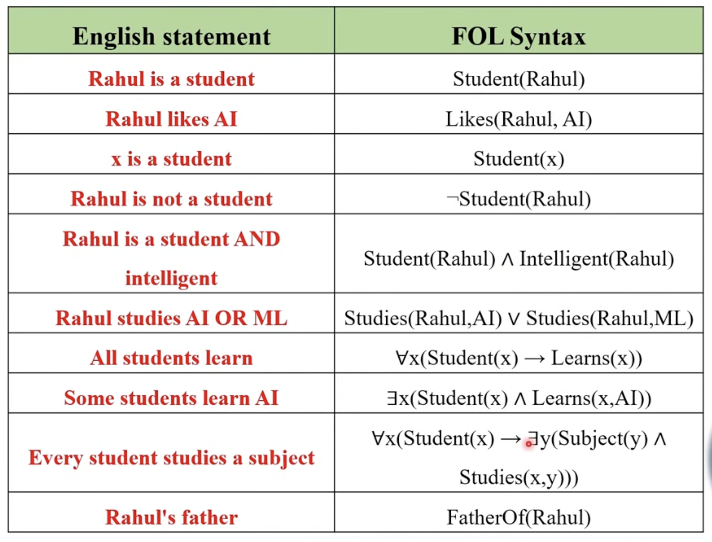

---

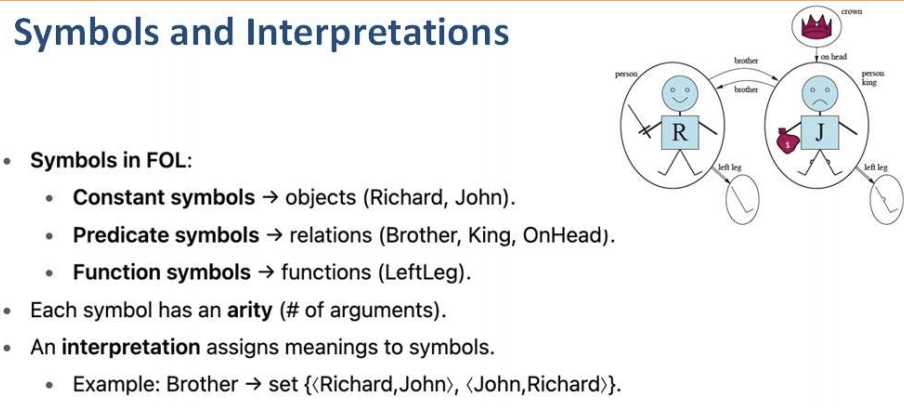
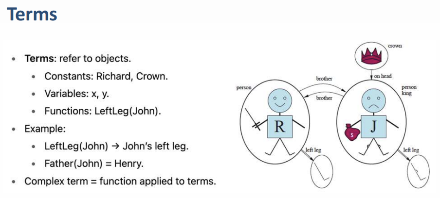
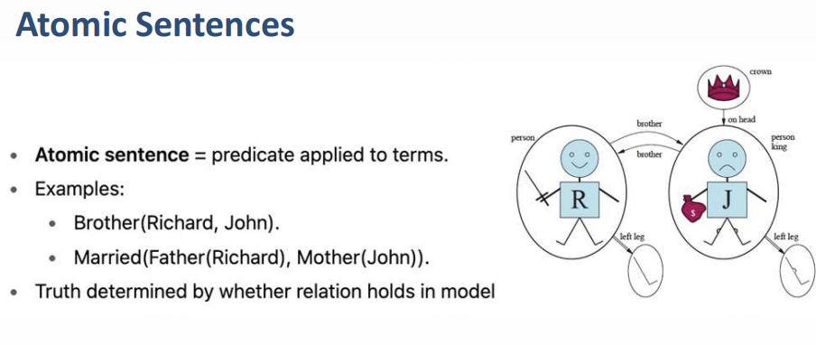
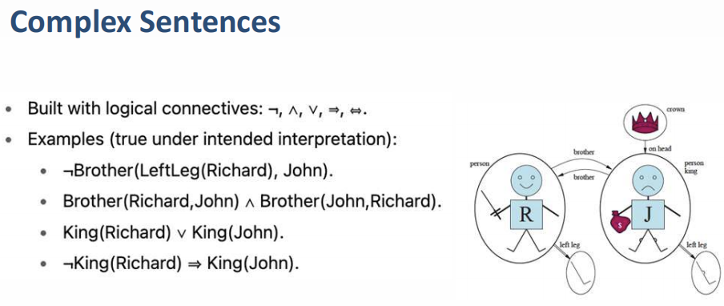

---

| Quantifier | English Keyword | Logical Connector | Why? |
| :--- | :--- | :--- | :--- |
| **$\forall$ (For all)** | "All", "Every", "Everyone" | **Implication ($\rightarrow$)** | Acts as a filter so you only evaluate the specific objects you care about (and ignore everything else in the universe). |
| **$\exists$ (There exists)** | "Some", "At least one" | **Conjunction ($\land$)** | Acts as a strict link demanding that a single object must satisfy both conditions at the exact same time. |