# First Order Logic

In prepositional logic has statements with operators. But for some keyworkds like `All`, `Every`, `Some` we uses `First Order Logic` syntax

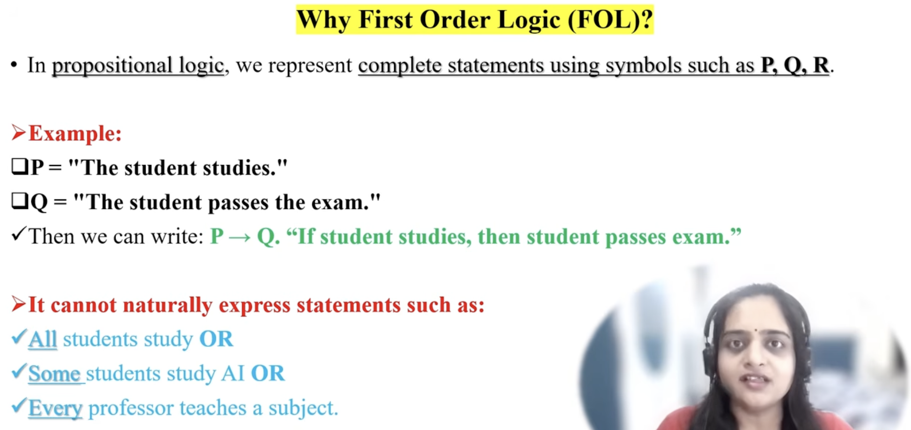

 

## Syntax

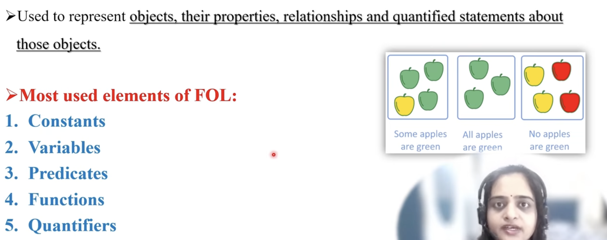

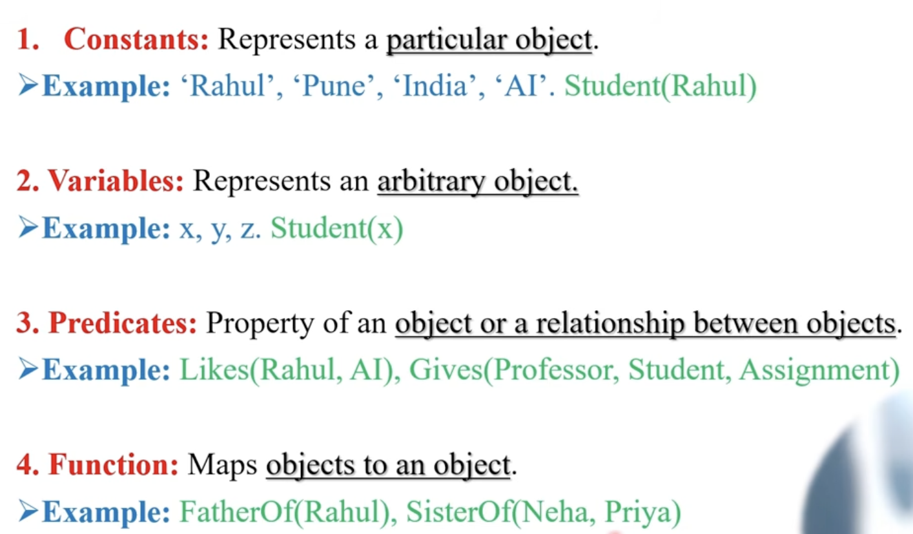

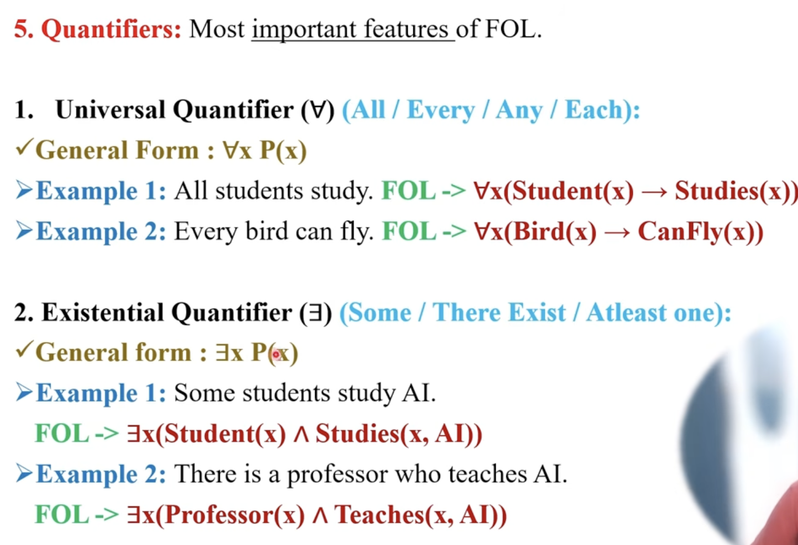

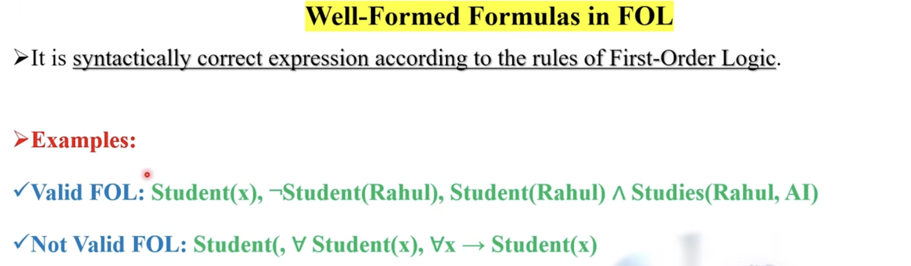

 

## Translate Natural to FOL

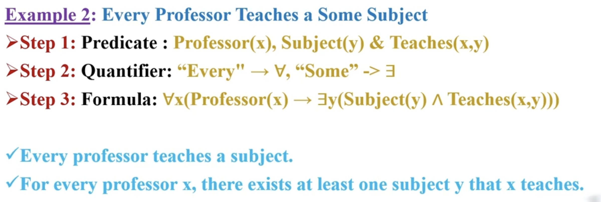

 

## Examples

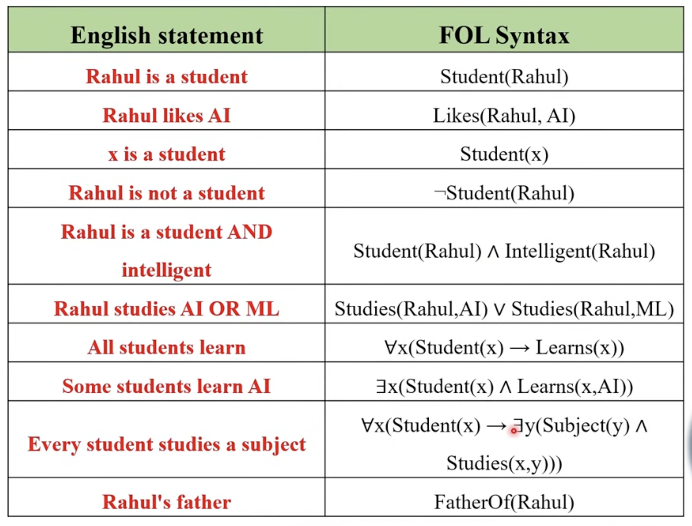

---

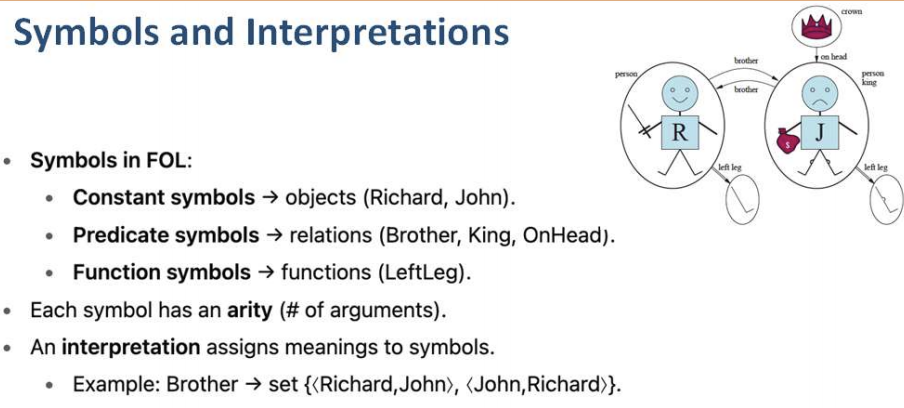
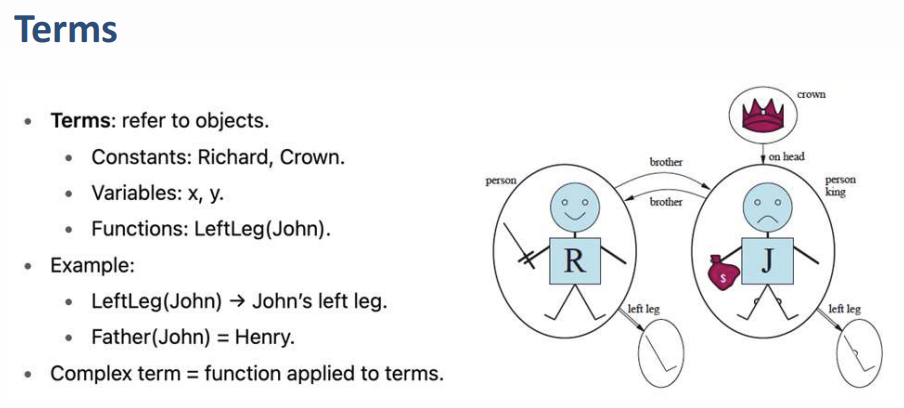
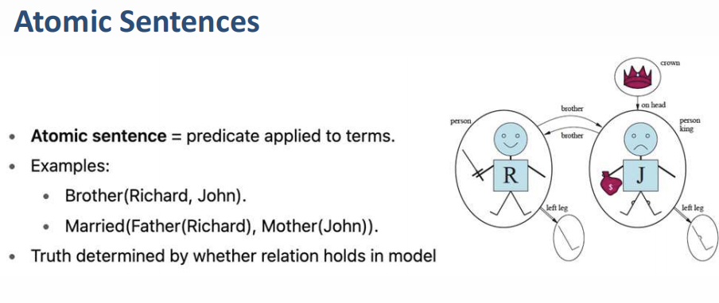
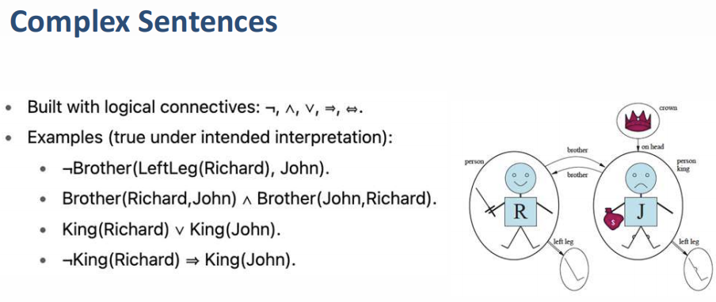
