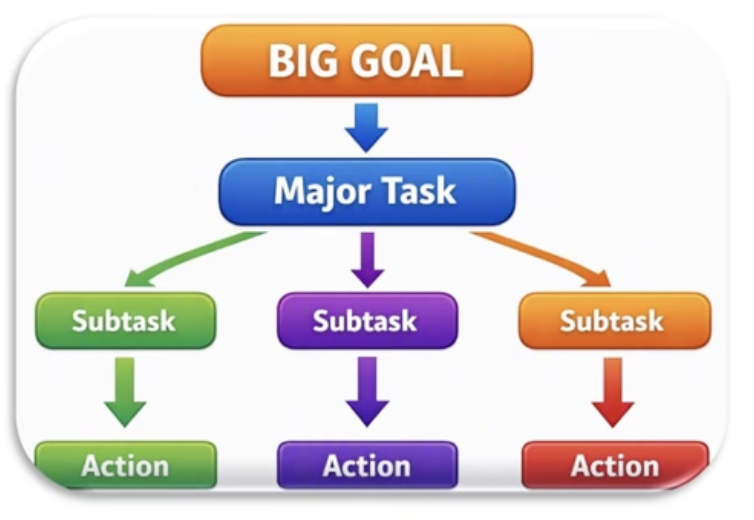
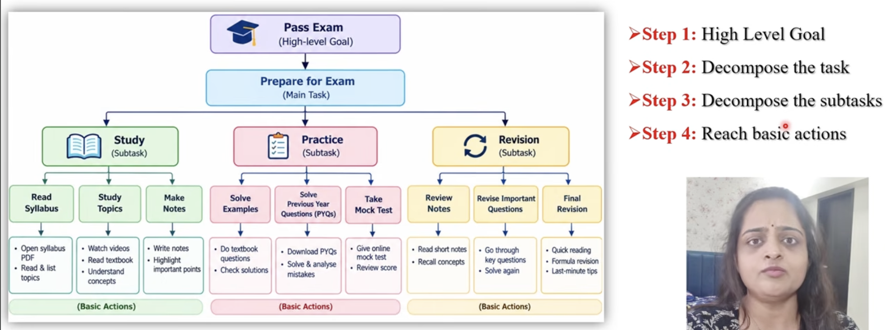
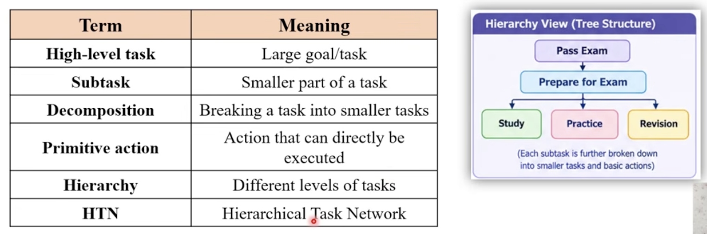

# Hierarchical Planning

- It means solving a `large/complex goal by breaking it into smaller and simpler tasks`

- Breaking those tasks into smaller actions until we get actions that can actually be performed

- It is also called `Hierarchical Task Network (HTN) Planning`

 

 

## Example

