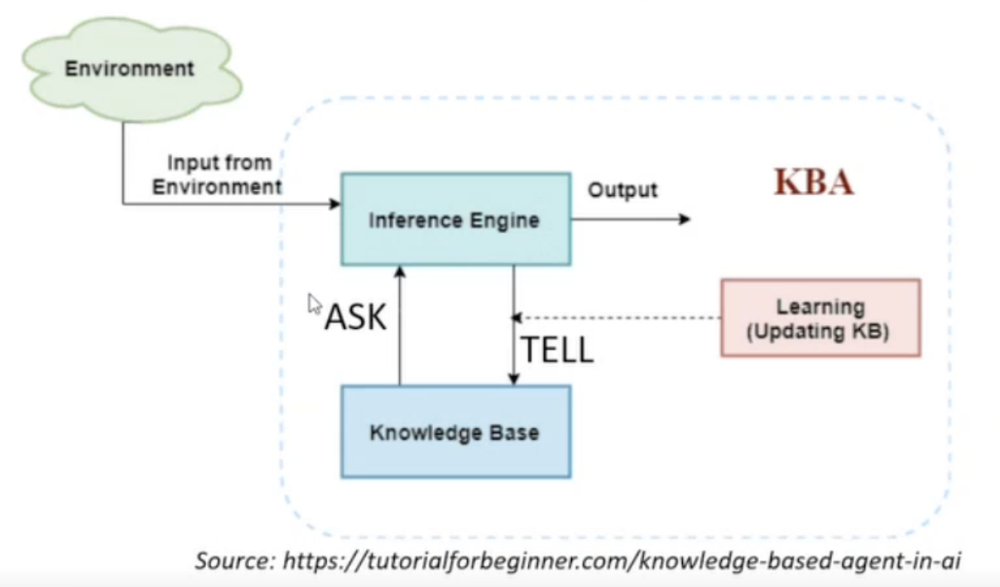
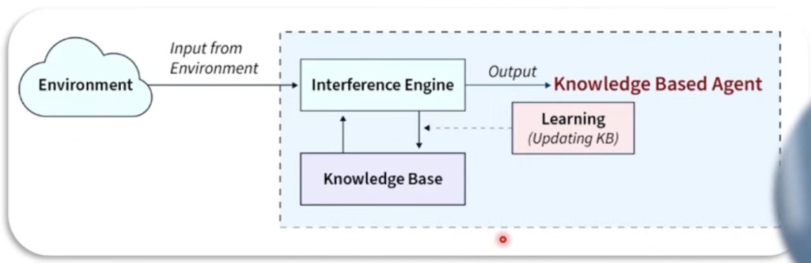
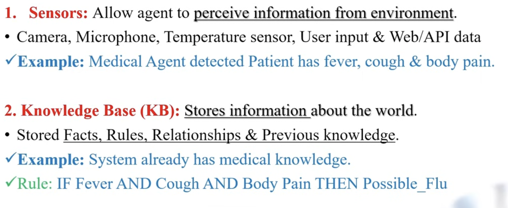
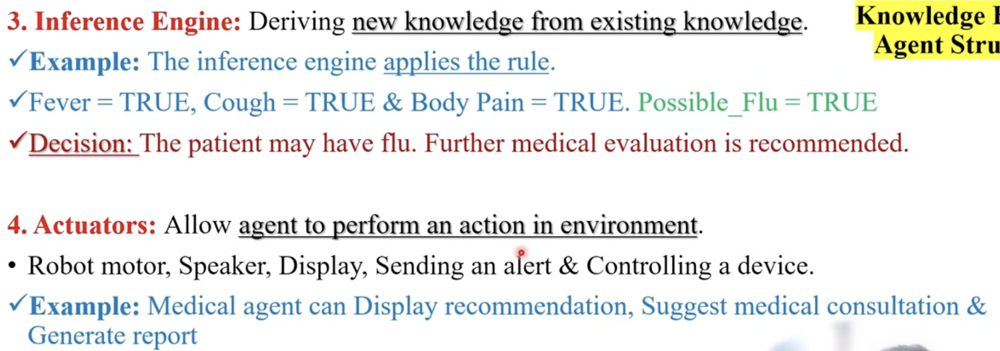
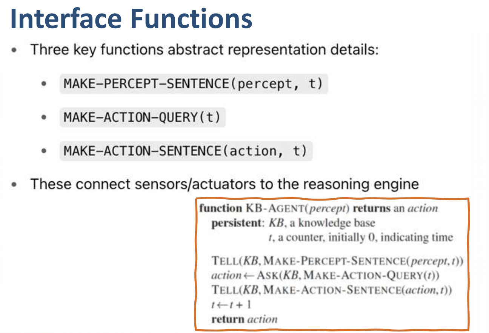
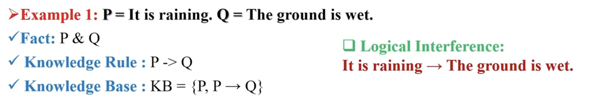
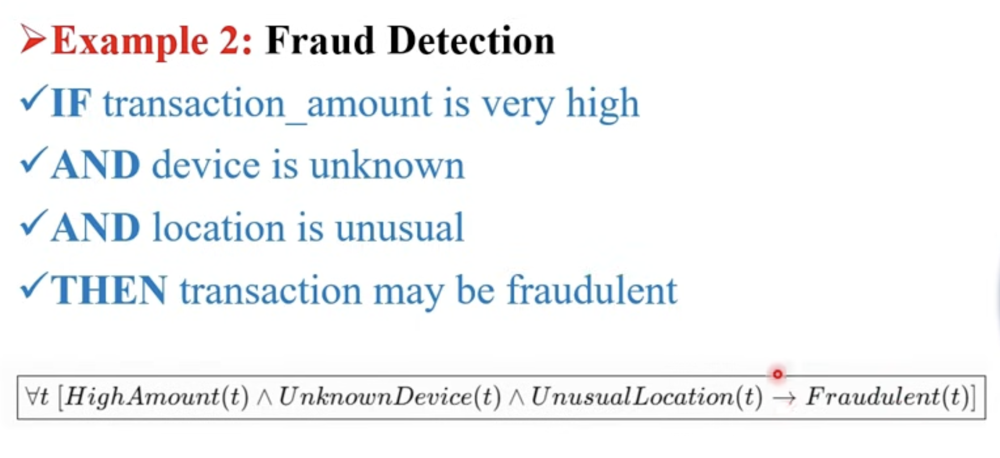
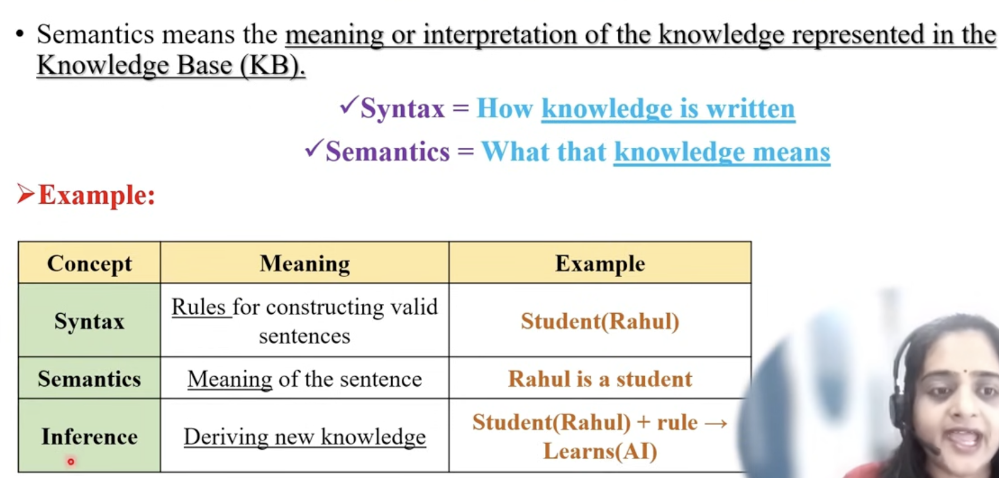

# Knowledge Based Agents

- Knowledge Based Agent is and `Intelligent Agent`
- Stores knowledge about the world and use that knowledge to reason, make decisions and take actions
- They are using [first order logic](./fol.md) and [propositional logic](./pl.md)

 

## Architecture

Main Components are:

 

 

## Agent Syntax

- Syntax refers to the formal way in which knowledge is represented and written inside a `Knowledge Base` (KB).
- Agent uses a formal language to represent `Facts`, `Objects`, `Properties`, `Relationships`, `Rules & Logical statements`.

 

## Examples

 

## Semantics

