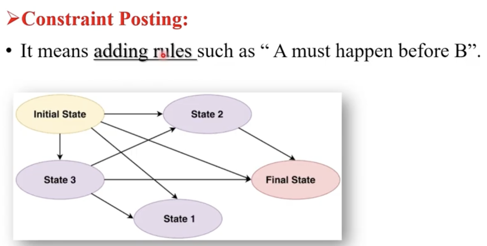

# Non Linear Planning

- Nonlinear planning means we do not decide the exact order of all actions at the beginning.   

- Instead, we first decide which actions are required and then add constraints to specify which actions must happen before others.

 

 

## Examples

