# Propositional Logic

- Simplest logic in AI
- One of the simplest forms of logic used in Knowledge-Based Agents
- Represent facts, statements and relationships between statements and to derive new conclusions using inference rules
- A proposition is a declarative statement that is either `True (T)` or `False (F)` but `not both`.

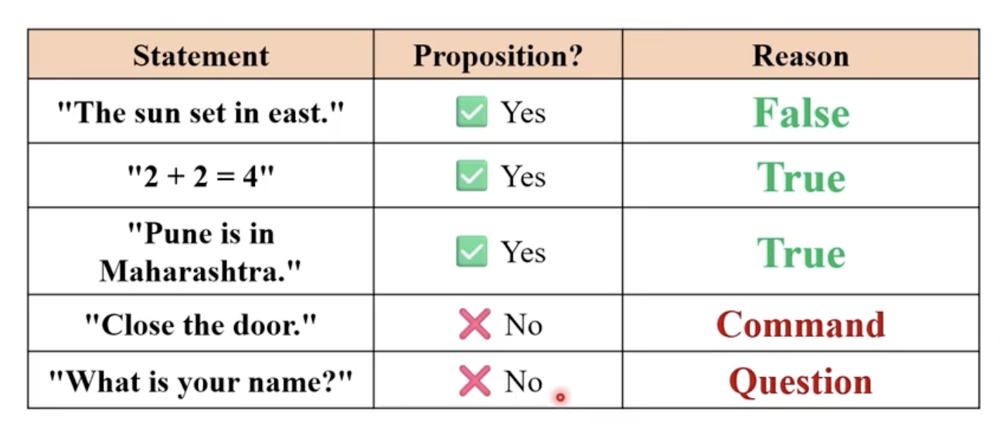

<br/>

## Propositional Operators

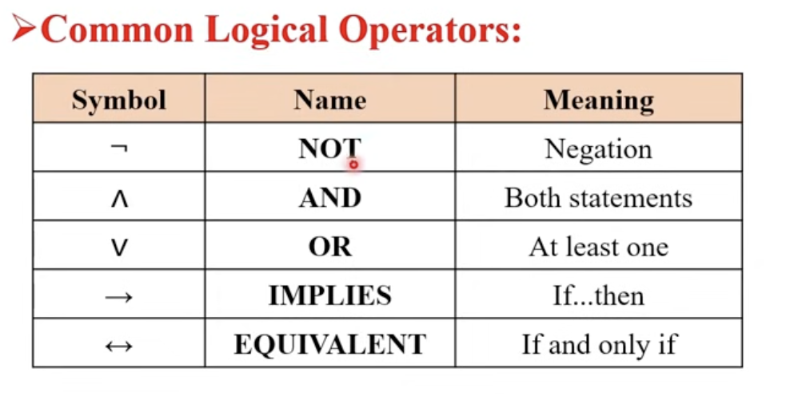

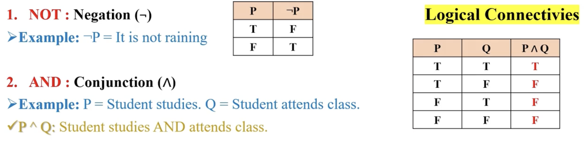

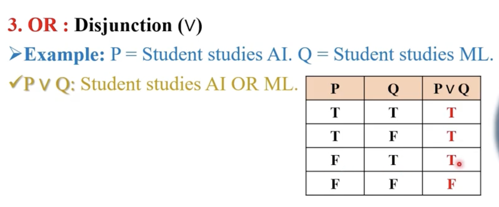

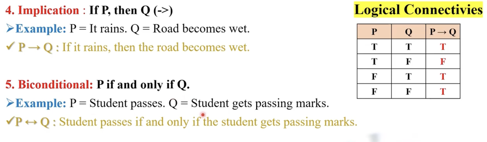

---

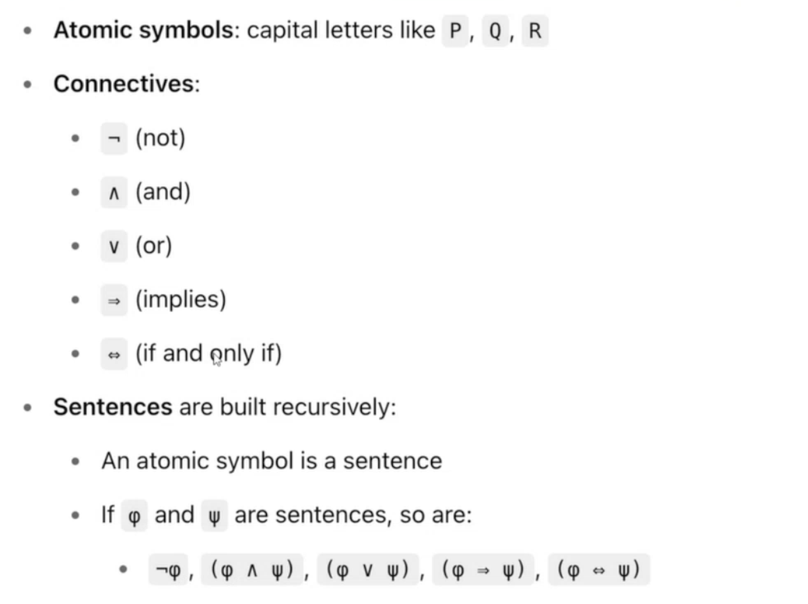
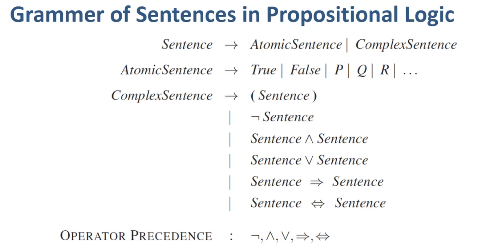
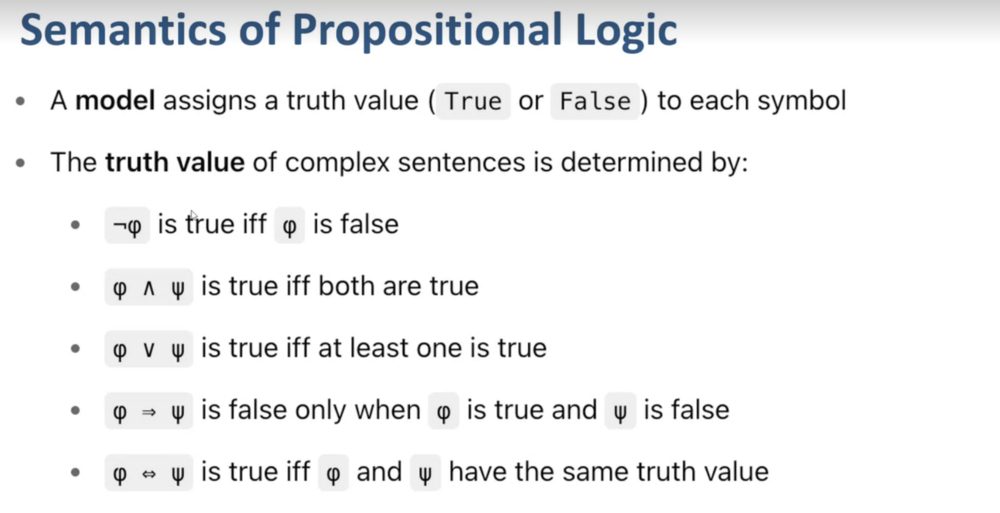
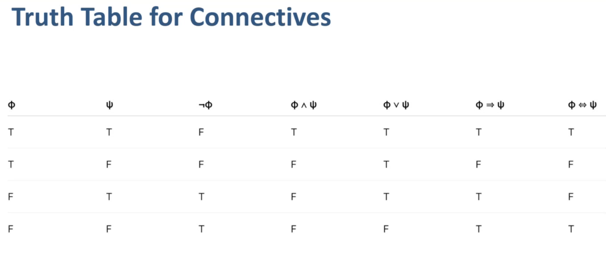

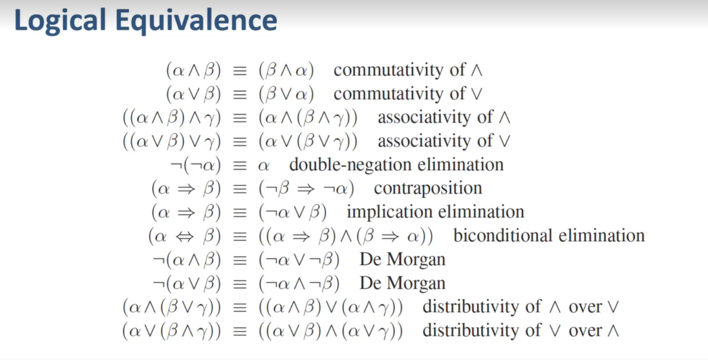

<br/>

## Propositional Symbols & Well Formed Formulas

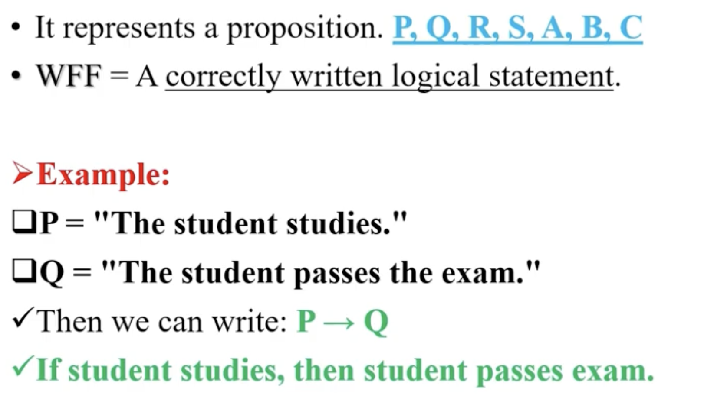
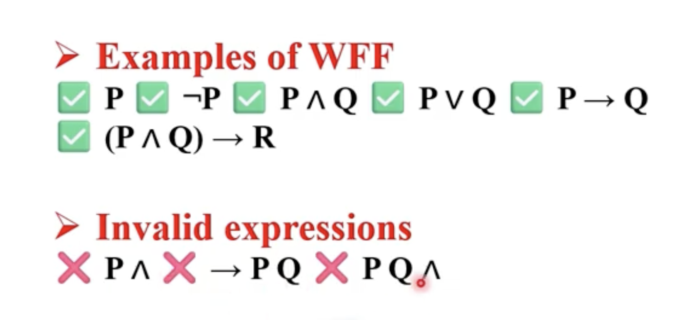

<br/>

## Entailment

This is about redundency in `KB`

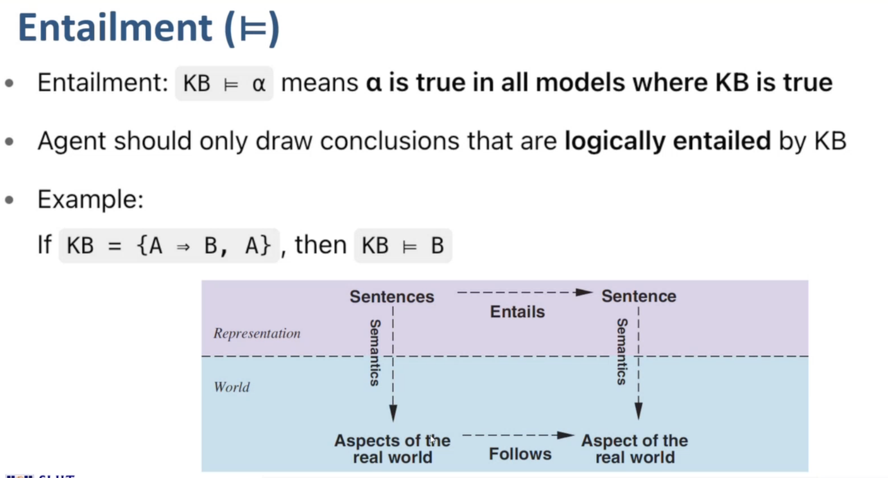

Meaning that,

```
Ex: There are `A` and `B`
KB={A, A->B}.  ---> correct one because b enatilment
KB={A, B, A->B}.  ---> wrong because b enatilment so we dont need to add B seperately
```

<br/>

## Inference in Propositional Logic

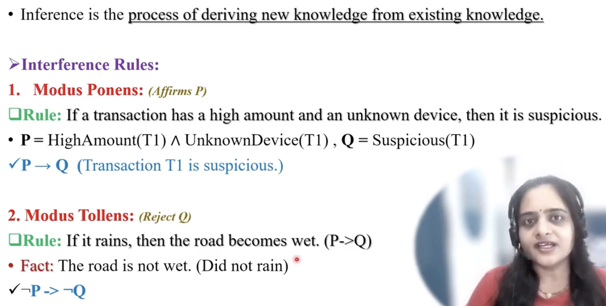

<br/>

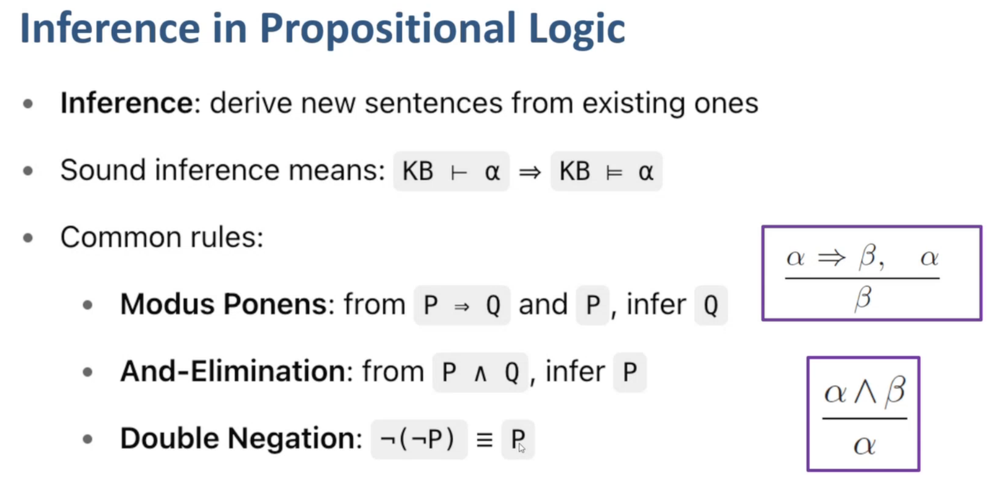

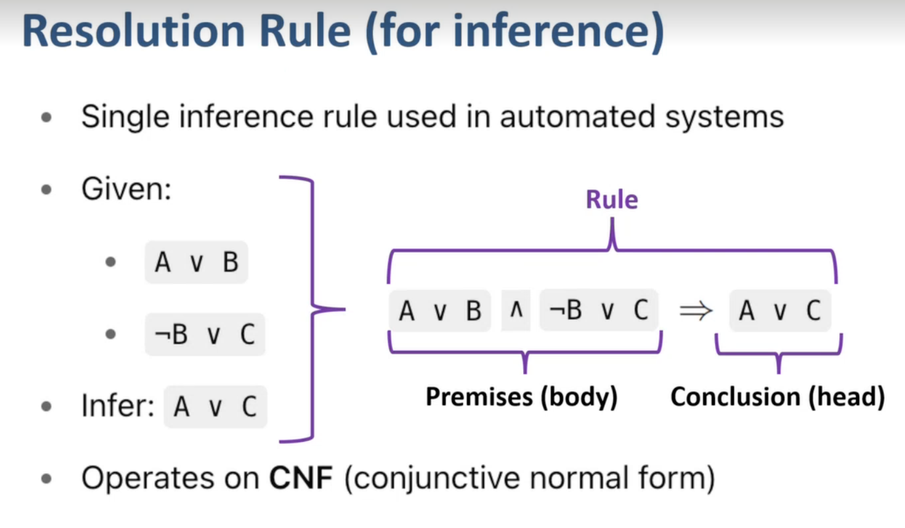

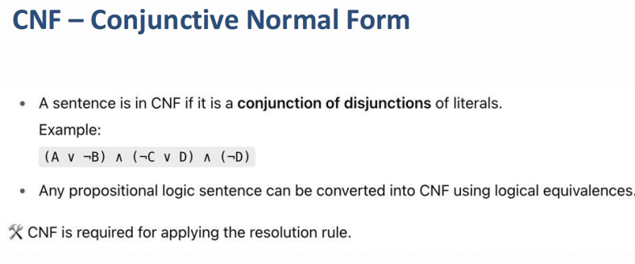
