# Propositional Logic

- Simplest logic in AI
- One of the simplest forms of logic used in Knowledge-Based Agents
- Represent facts, statements and relationships between statements and to derive new conclusions using inference rules
- **A proposition is a declarative statement that is either `True (T)` or `False (F)` but `not both`.**

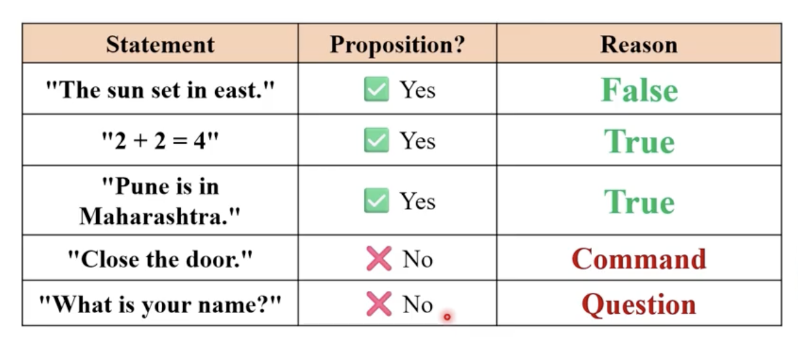

<br/>

## Propositional Operators

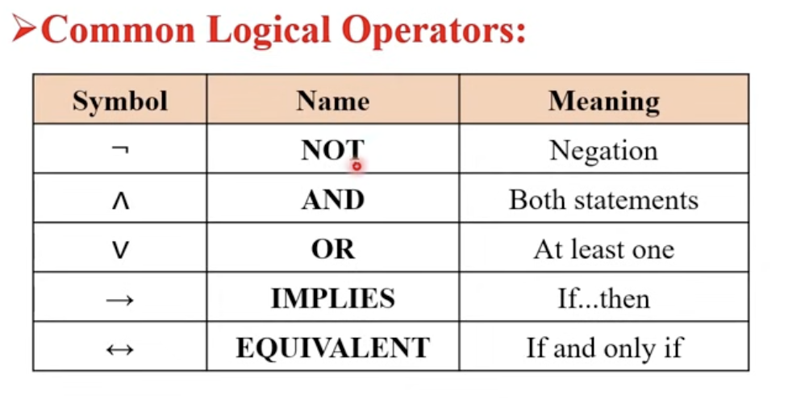

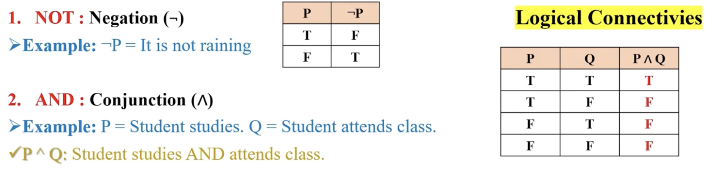

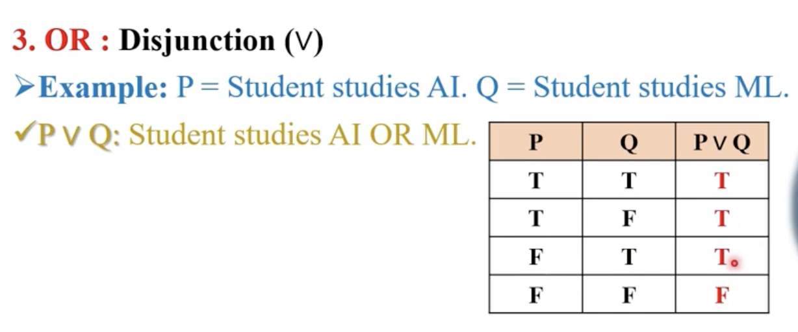

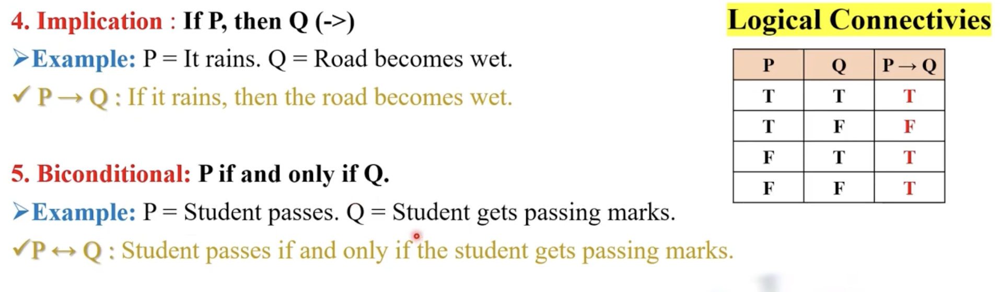

---

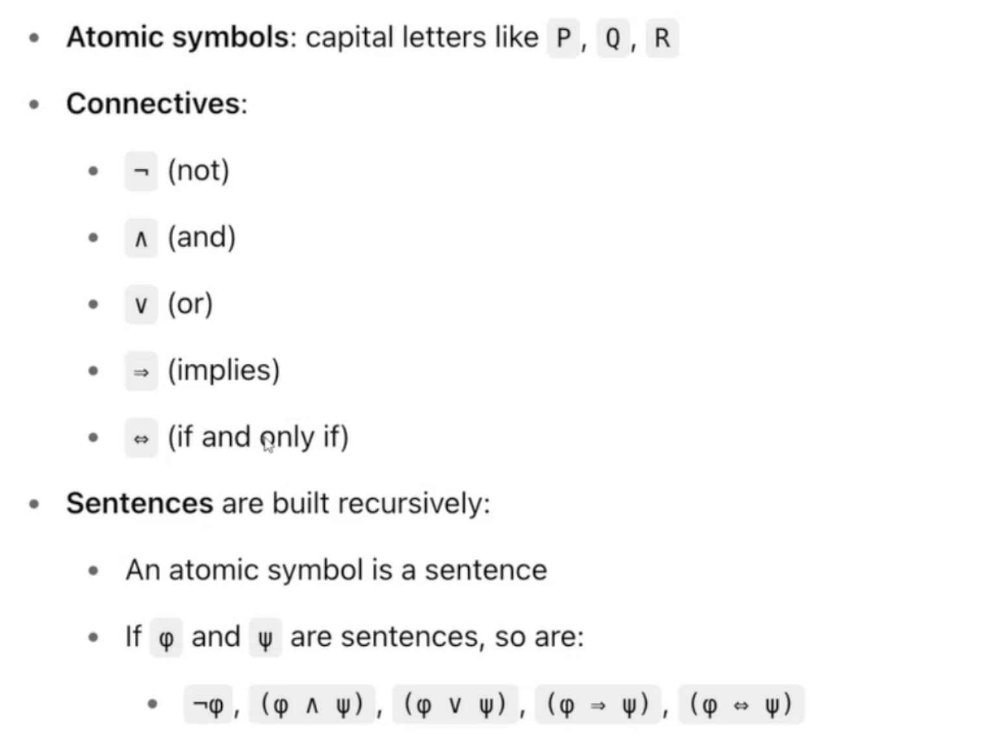
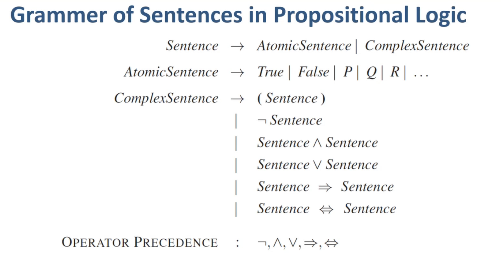
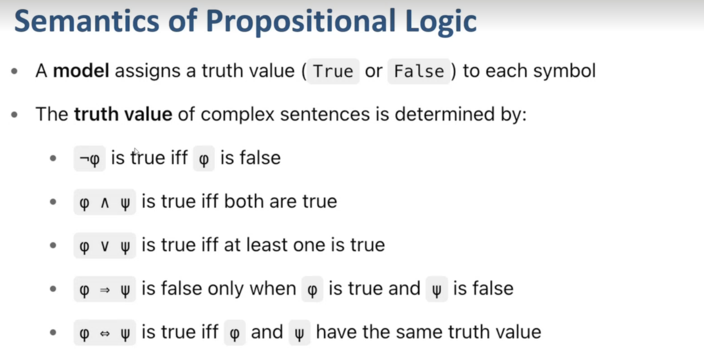
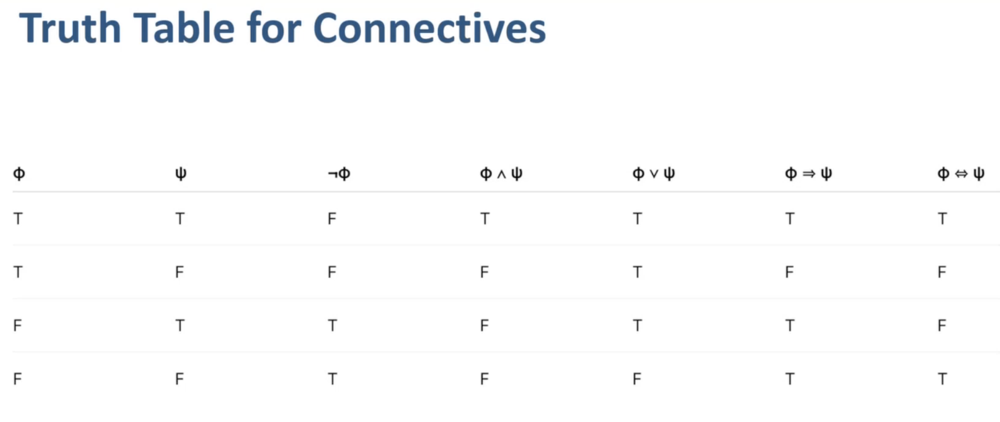

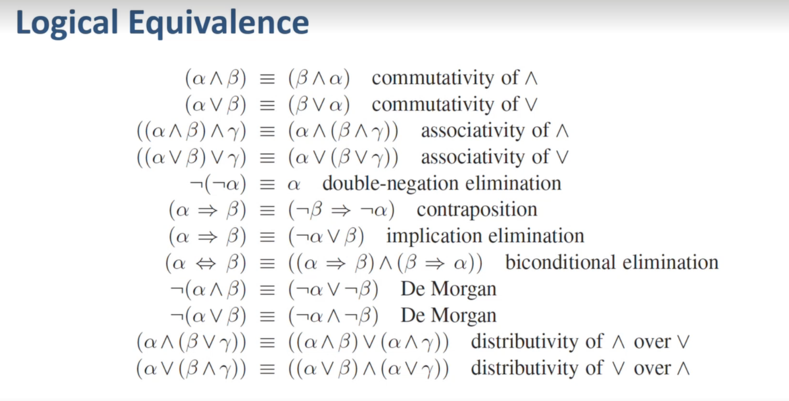

<br/>

## Propositional Symbols & Well Formed Formulas

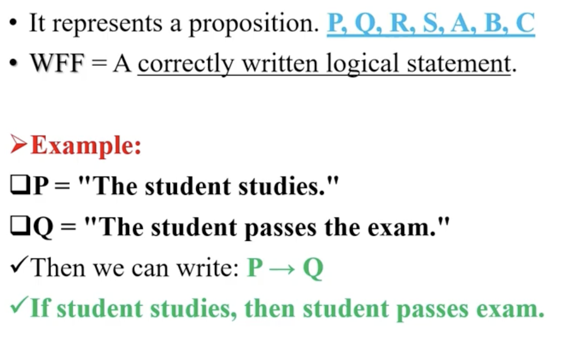
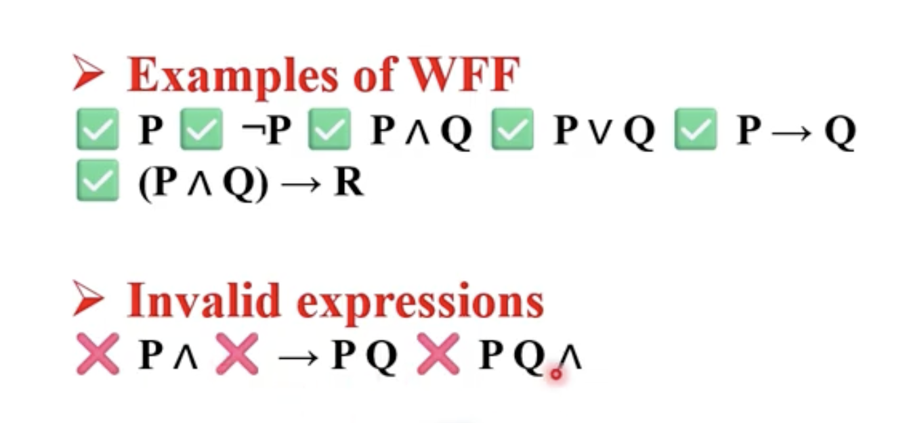

<br/>

## Entailment

This is about redundency in `KB`

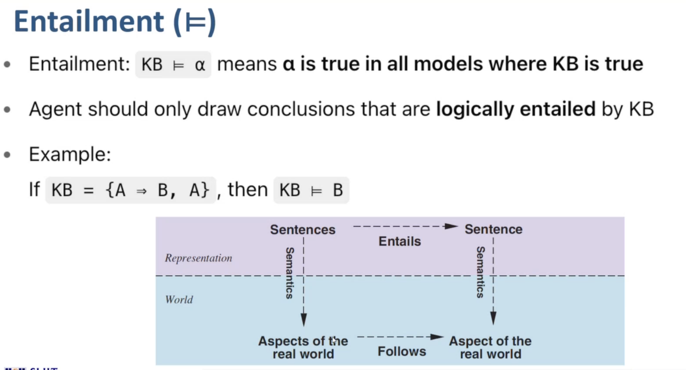

Meaning that,

```
Ex: There are `A` and `B`
KB={A, A->B}.  ---> correct one because b enatilment
KB={A, B, A->B}.  ---> wrong because b enatilment so we dont need to add B seperately
```

<br/>

## Inference in Propositional Logic

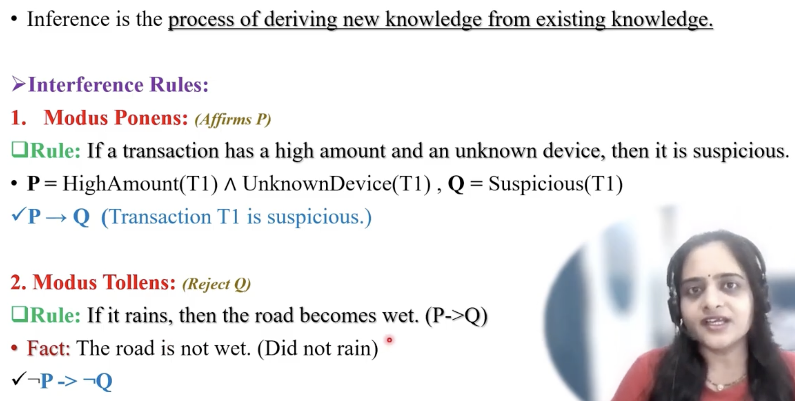

<br/>

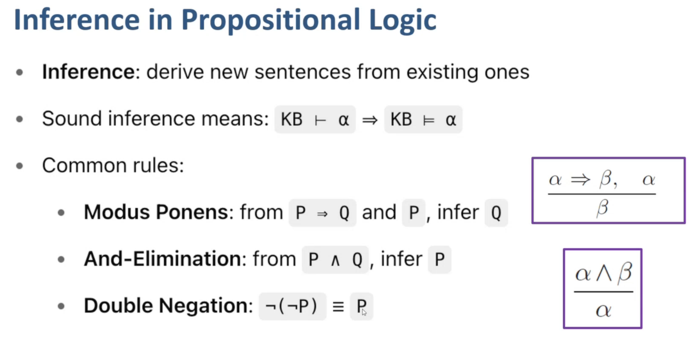

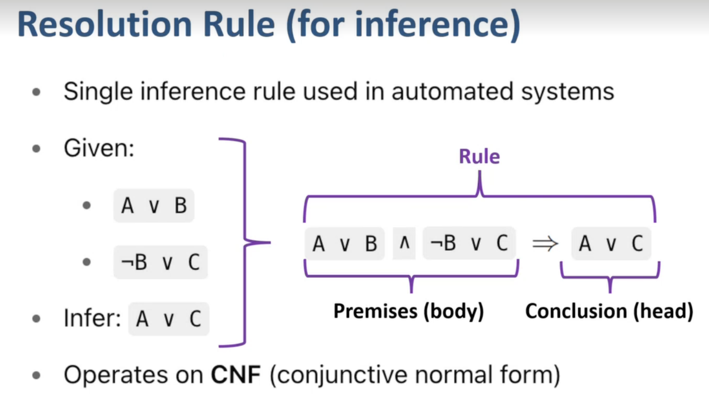

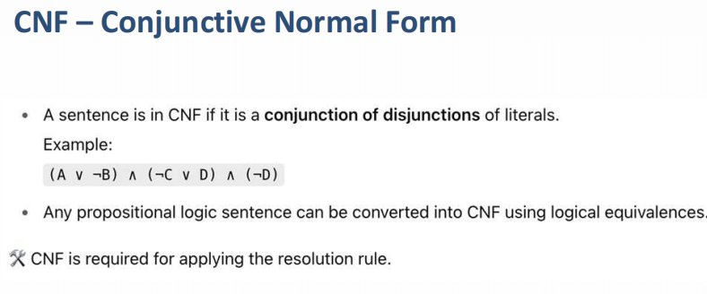

<br/>

## Equivalence Laws

#### 1. Idempotent Law

\(P \lor P \equiv P\)

In plain terms, saying something is true or itself adds no new information or change in truth value:

• If P is True, then (\(T \lor T\)) is True (P).
• If P is False, then (\(F \lor F\)) is False (P).

<br/>

#### 2. Commutative Law

\(P \lor Q \equiv Q \lor P\)

\(P \land Q \equiv Q \land P\)

\(P \leftrightarrow Q \equiv Q \leftrightarrow P\)

but,

\(P \rightarrow Q\) is not equivalent to \(Q \rightarrow P\)

<br/>

#### 3. Associative Law

Can change the brackets as we want

\((P \lor Q) \lor R \equiv P \lor (Q \lor R)\)

\((P \land Q) \land R \equiv P \land (Q \land R)\)

\((P \leftrightarrow Q) \leftrightarrow R \equiv P \leftrightarrow (Q \leftrightarrow R)\)

<br/>

#### 4. Distributive Law

\(P \land (Q \lor R) \equiv (P \land Q) \lor (P \land R)\)

\(P \lor (Q \land R) \equiv (P \lor Q) \land (P \lor R)\)

<br/>

#### 5. Demorgan Law

\(\neg(P \land Q) \equiv \neg P \lor \neg Q\)

\(\neg(P \lor Q) \equiv \neg P \land \neg Q\)

<br/>

#### 6. Absorption Law

\(P \lor (P \land Q) \equiv P\)

\(P \land (P \lor Q) \equiv P\)

<br/>

#### 7. Implication Removal

\(P \rightarrow Q \equiv \neg P \lor Q\)

\(P \leftrightarrow Q \equiv (P \rightarrow Q) \land (Q \rightarrow P)\)

<br/>

#### 8. Contrapositive Law

\(P \rightarrow Q \equiv \neg Q \rightarrow \neg P\)

<br/>

#### 9. Double Negation Law

\(\neg(\neg P) \equiv P\)

<br/>

#### 10. Fundamentals

\(P \lor \neg P = T\)
\(P \land \neg P = F\)
\(P \lor T = T\)
\(P \land F = F\)
\(P \land T = P\)
\(P \lor F = P\)

<br/>

## Limitations

- `Some`, `All`, `Every` keywords couldn't represent with this
- Limited in expressing power
- Don't have relations, objects mappings
