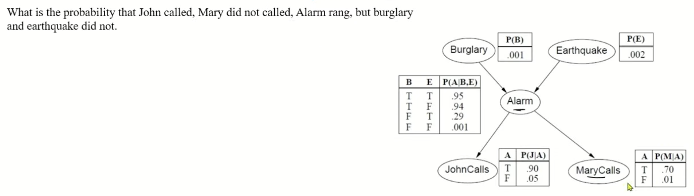
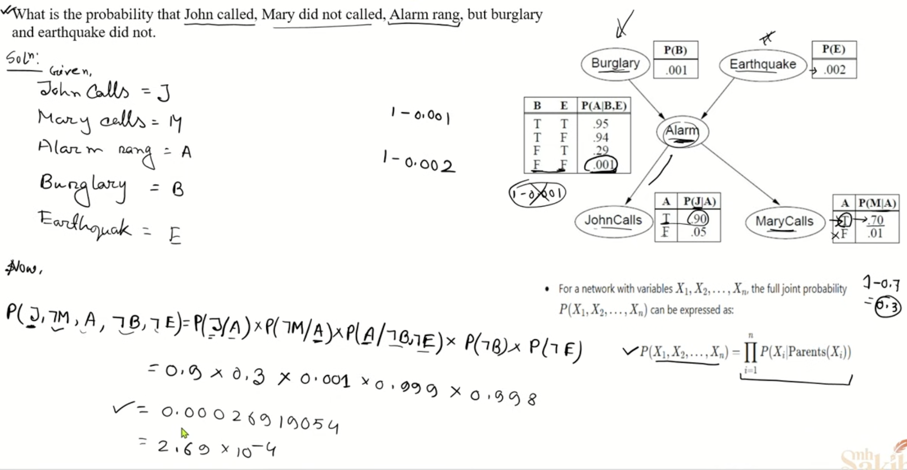
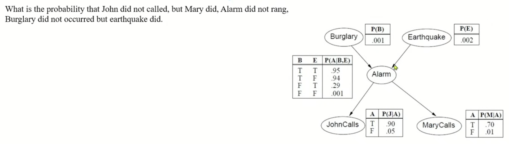
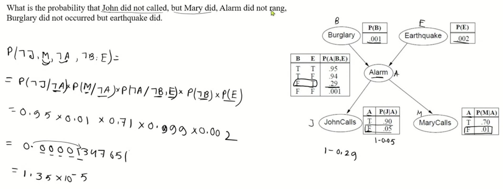

# Beysien Netwroks

In the real world, things are rarely 100% certain. We live in shades of gray. A Bayesian Network is a Probabilistic Graphical Model (PGM) that allows an AI to reason under uncertainty.

It consists of two main parts:

- `The Graph (Structure)`: A map made of Nodes (representing variables/events) and Directed Arrows (representing direct causal influences or dependencies). This is technically a `Directed Acyclic Graph` (DAG), meaning the arrows have a direction, and you can never follow arrows in a loop back to where you started.

- `The Numbers (Conditional Probability Tables - CPTs)`: Behind every node is a table that defines the exact mathematical probability of that node happening based on what its "parents" (the nodes pointing to it) are doing.

<br/>

## The Math Under the Hood (The Chain Rule)

Instead of trying to calculate the probability of every single variable happening all at once, Bayesian networks use the Chain Rule for Bayesian Networks

```
The joint probability of all variables in the network is simply the product of the probability of each node given its parents
```

$$P(X_1, X_2, \dots, X_n) = \prod_{i=1}^{n} P(X_i \mid \text{Parents}(X_i))$$

This factorization is the "magic trick" of BNs. It breaks down a massive, terrifying joint probability calculation into small, manageable local conditional probabilities.

<br/>

$P(X_1, X_2, \dots, X_n)$: This is the joint probability—the overall chance that every single event in your network happens together at the exact same time.

$\prod_{i=1}^{n}$: Just like $\sum$ (sigma) means "add everything up", $\prod$ (capital pi) means "multiply everything together."

$P(X_i \mid \text{Parents}(X_i))$: This is the core rule. It means "the probability of a specific node ($X_i$) happening, given only its direct causes (its parents)."

<br/>

## Example

#### Clouds, Rain, and Wet Grass

Imagine a simple 3-node weather network:

Cloud ($C$) causes Rain ($R$).
Rain ($R$) causes Wet Grass ($W$).

`Graph layout`: $C \rightarrow R \rightarrow W$

Normally, in standard probability, to find the joint probability of all three happening together $P(C, R, W)$, you would have to calculate a massive, messy equation based on conditional chains:

$$P(C, R, W) = P(C) \times P(R \mid C) \times P(W \mid C \text{ and } R)$$

Where the Bayesian Network Shortcut Kicks In:

Look at the last term: $P(W \mid C \text{ and } R)$.
Does the grass care if there are clouds in the sky, as long as you already know it is raining? No. Once you know rain is happening, the clouds don't give you any extra information about whether the grass is wet.

Because of the network's structure, we can drop $C$ from that condition. It simplifies to just $P(W \mid R)$ (Wet Grass given Rain).

Applying our formula, the joint probability breaks down into a clean, easy product of local probabilities:

$$P(C, R, W) = P(C) \times P(R \mid C) \times P(W \mid R)$$

<br/>

## Questions

[Watch Youtube Vedio](https://www.youtube.com/watch?v=BD5aY6i9MhU)

<br/>

### Question 1




### Question 2



