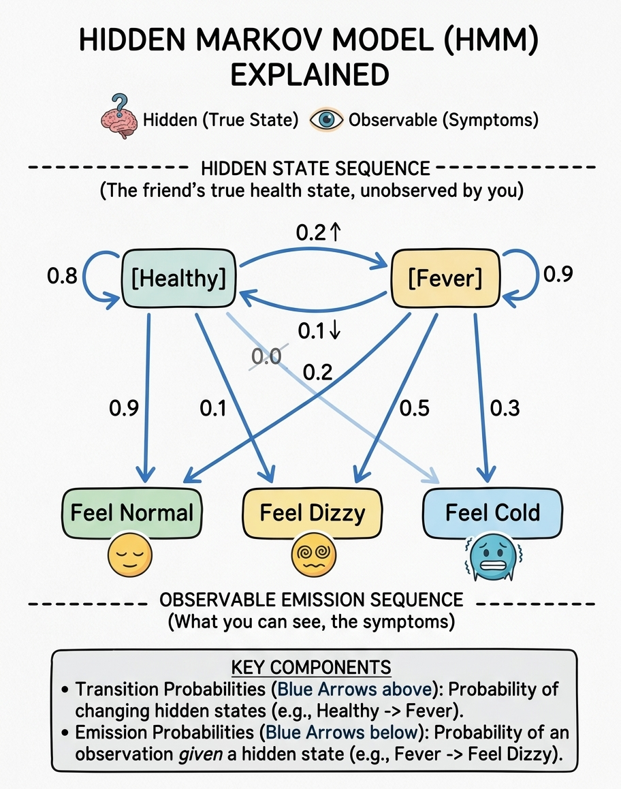

# Hidden Markov Models (HMMs)

Real-world problems are rarely so transparent. Often, the true underlying state of a system is hidden from us, but we can observe `outward signals or symptoms that depend on that hidden state`. This is a `Hidden Markov Model (HMM)`.

The Two Hierarchies of HMMs:

1. `The Hidden Process`: A Markov chain of unobserved (hidden) states $Z_1, Z_2, \dots, Z_T$.

2. `The Observation Process`: At each time step, the hidden state emits an observable output $O_t$ based on a probability distribution.

 

**Core Parameters of an HMM**

$A$ `(Transition Probabilities)`: Probability of moving between hidden states $P(Z_t \mid Z_{t-1})$.

$B$ `(Emission Probabilities)`: Probability of observing output $v_k$ given that the system is in hidden state $s_j$: $B_{jk} = P(O_t = v_k \mid Z_t = s_j)$.

$\pi$ `(Initial State Distribution)`: Starting probabilities for the hidden states.

 

## The Three Fundamental Problems of HMMs

When working with HMMs in machine learning, you typically solve three core algorithmic problems:

| Problem | Goal | Standard Algorithm |
| :--- | :--- | :--- |
| **1. Evaluation** | Compute the probability of a specific observation sequence given the model parameters. | **Forward-Backward Algorithm** |
| **2. Decoding** | Find the most likely sequence of *hidden* states that led to a given observation sequence. | **Viterbi Algorithm** |
| **3. Learning** | Adjust the model parameters ($A, B$) to best fit a set of observed training sequences. | **Baum-Welch Algorithm** (Expectation-Maximization) |

 

**Example: The Doctor and the Patient**

Imagine trying to deduce whether a friend has a Fever or is Healthy (Hidden States), but you can only observe whether they feel Normal, Dizzy, or Cold (Observations) when they visit you. The underlying state drives the symptoms, but you only see the symptoms.

