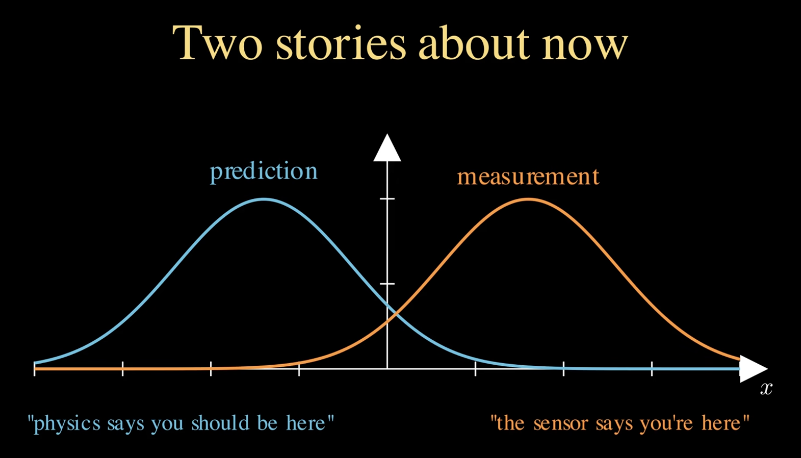
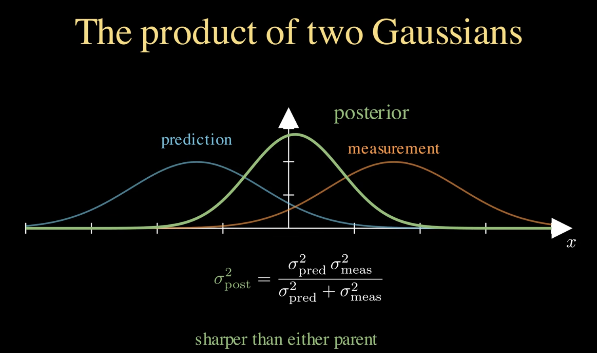
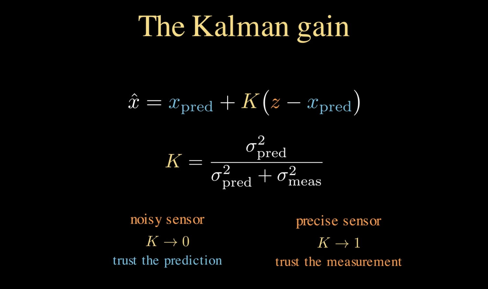
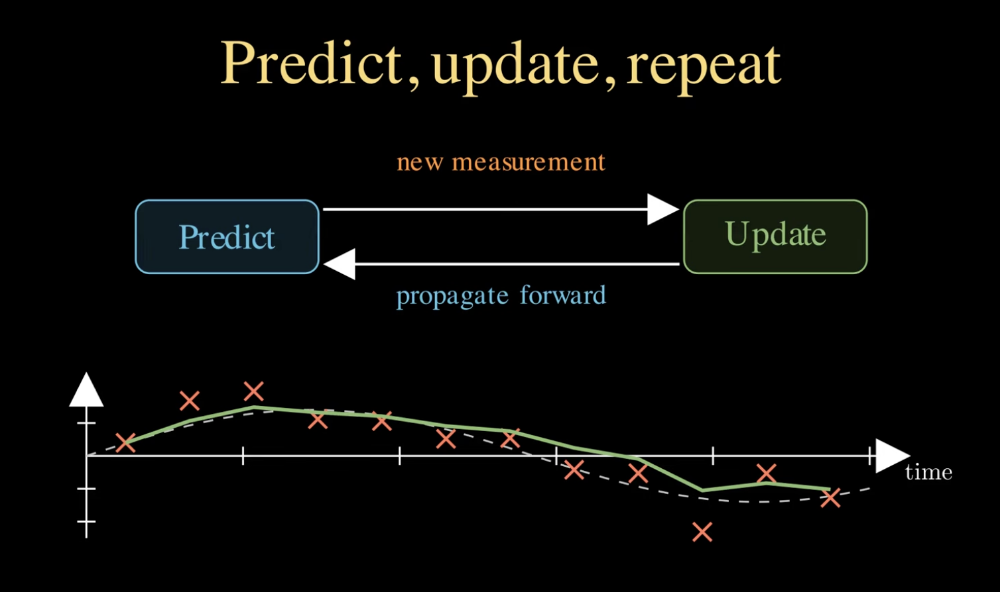

# Kalman Filters

A `Kalman Filter` is an optimal recursive data processing algorithm designed to estimate the true, hidden state of a continuous dynamic system from a series of noisy sensor measurements over time.

<br/>

So kalman filter looking,



- **State Prediction**
- **Sensor Measurements**

and after that get both of the common mean value as the most optimal value.



It calculates a weight called the **Kalman Gain ($K$)**, which is essentially a percentage telling it how much to trust the sensor vs. the model.



It has 2 Steps to get the optimal value



**1. State Predict / The Guess (Predict):** - Use mathematical model to predict
**2. State Update / The Measurement (Update)** - Improve the prediction value using sensor measurements

<br/>

## Scenario & Equations

```
┌───────────────────────────────────────────────────────----─┐
│                   1. PREDICT STEP                          │
│ Project State:      x̂_{k|k-1} = F_k x̂_{k-1|k-1} + B_k u_k  │ 
│ Project Covariance: P_{k|k-1} = F_k P_{k-1|k-1} F_kᵀ + Q_k │
└──────────────────────────┬─────────────────────────────----┘
                           │
                           ▼
┌────────────────────────────────────────────────────────┐
│                   2. UPDATE STEP                       │
│ Residual:          ỹ_k = z_k - H_k x̂_{k|k-1}           │
│ Innovation Cov:    S_k = H_k P_{k|k-1} H_kᵀ + R_k      │
│ Kalman Gain:       K_k = P_{k|k-1} H_kᵀ S_k⁻¹          │
│ State Update:      x̂_{k|k} = x̂_{k|k-1} + K_k ỹ_k       │
│ Covariance Update: P_{k|k} = (I - K_k H_k) P_{k|k-1}   │
└────────────────────────────────────────────────────────┘
```

<br/>

#### Step 1: Predict (Time Update)

Projects the state estimate and error covariance forward in time using the physical model before checking any sensor data.

**Predicted State Estimate:**
$$\hat{x}_{k\vert{}k-1} = F_k \hat{x}_{k-1\vert{}k-1} + B_k u_k$$

**Predicted Error Covariance:**
$$P_{k\vert{}k-1} = F_k P_{k-1\vert{}k-1} F_k^\top + Q_k$$

<br/>

#### Step 2: Update (Measurement Correction)

Blends the predicted state with the new incoming noisy sensor reading $z_k$ using the optimal Kalman Gain ($K_k$).

**Innovation / Residual ($\tilde{y}_k$):**$$\tilde{y}_k = z_k - H_k \hat{x}_{k\vert{}k-1}$$(Difference between sensor reading and expected reading)

**Innovation Covariance ($S_k$):**$$S_k = H_k P_{k\vert{}k-1} H_k^\top + R_k$$**Kalman Gain ($K_k$):**$$K_k = P_{k\vert{}k-1} H_k^\top S_k^{-1}$$
- If Sensor Noise ($R$) is high $\rightarrow K \to 0$ (Trust the Physics Model).
- If Model Noise ($Q$) is high $\rightarrow K$ increases (Trust the Sensor Reading).

**Updated State Estimate:**$$\hat{x}_{k\vert{}k} = \hat{x}_{k\vert{}k-1} + K_k \tilde{y}_k$$

**Updated Error Covariance:**$$P_{k\vert{}k} = (I - K_k H_k) P_{k\vert{}k-1}$$
