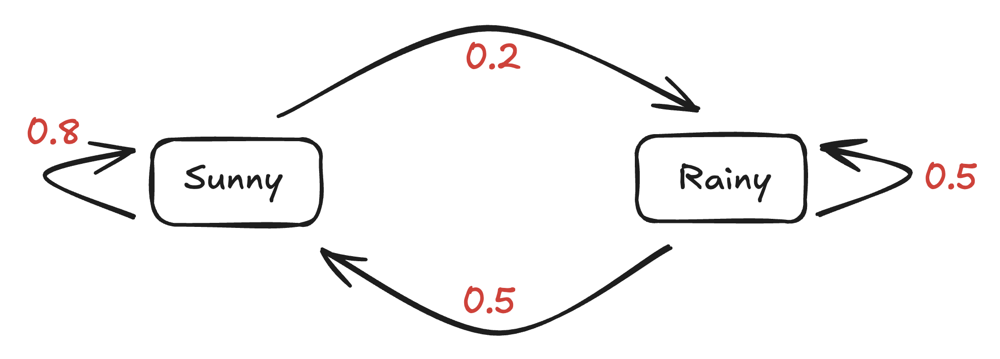
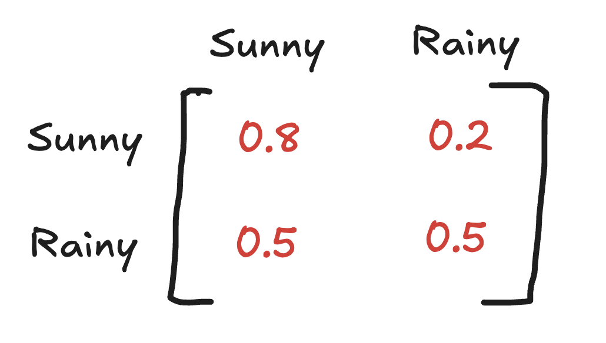
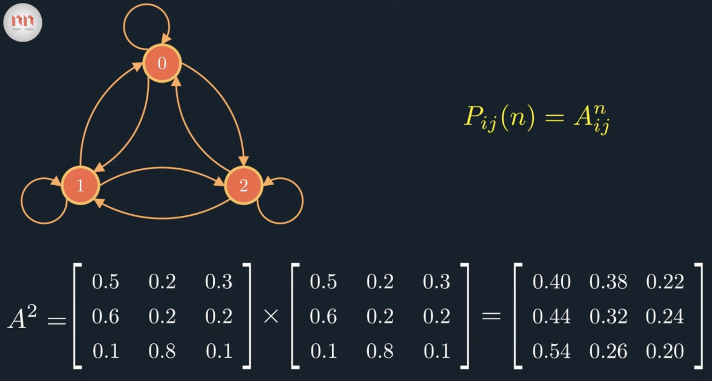

# Markov Chains (Visible Markov Models)

- the `states` of the system are fully `observable`
- Every time step corresponds to a direct state change

**Key Components:**

- `State Space` ($S$): A finite set of all possible states $\{s_1, s_2, \dots, s_n\}$.
- `Transition Probability Matrix` ($A$): An $n \times n$ matrix where each entry $A_{ij} = P(X_{t+1} = s_j \mid X_t = s_i)$ represents the probability of transitioning from state $i$ to state $j$. The rows of $A$ sum to 1.
- `Initial State Distribution` ($\pi$): The probability vector of starting in each state at $t = 0$.

**Example: The Weather Model**

Imagine a simplified weather system with two states: Sunny ($s_1$) and Rainy ($s_2$). If today is sunny, there is an 80% chance tomorrow is sunny and a 20% chance it rains. If today is rainy, there is a 50% chance for each tomorrow.

`State Space` $$S = \{s_1, s_2\} = \{\text{Sunny}, \text{Rainy}\}$$

 

`Transition Probability Matrix`,
$$A = \begin{bmatrix} P(\text{Sunny} \mid \text{Sunny}) & P(\text{Rainy} \mid \text{Sunny}) \\ P(\text{Sunny} \mid \text{Rainy}) & P(\text{Rainy} \mid \text{Rainy}) \end{bmatrix} = \begin{bmatrix} 0.8 & 0.2 \\ 0.5 & 0.5 \end{bmatrix}$$

 

`Initial State Distribution` ($\pi$),

Since the image doesn't define where we start, let's define a well-chosen starting vector assuming today is definitely Sunny:$$\pi = [P(\text{Sunny}), P(\text{Rainy})] = [1.0, 0.0]$$

How it is typically handled: In practice, if $\pi$ is not given, you either assume a uniform starting distribution (e.g., $\pi = [0.5, 0.5]$ for Sunny and Rainy) or define it based on a known starting condition (e.g., starting with a 100% chance of Sunny means $\pi = [1.0, 0.0]$).

 

**Calculate Day 2 Weather**

Suppose $$\pi = [P(\text{Sunny}), P(\text{Rainy})] = [1.0, 0.0]$$

Predicting Tomorrow's Weather ($t = 1$)

To find the probability distribution of the weather tomorrow ($t = 1$), we multiply our initial distribution vector ($\pi$) by the transition matrix ($A$):$$\text{Probability at } t = 1 = \pi \times A$$$$\begin{bmatrix} 1.0 & 0.0 \end{bmatrix} \times \begin{bmatrix} 0.8 & 0.2 \\ 0.5 & 0.5 \end{bmatrix}$$

`Chance of Sunny tomorrow`: $(1.0 \times 0.8) + (0.0 \times 0.5) = 0.80$ (or 80%)

`Chance of Rainy tomorrow`: $(1.0 \times 0.2) + (0.0 \times 0.5) = 0.20$ (or 20%)

So, for Day 1, our distribution is `[0.8, 0.2]`.

Predicting Further Ahead ($t = 2$)

To find out what happens the day after tomorrow ($t = 2$), we take our new distribution and multiply by $A$ again:$$\text{Probability at } t = 2 = [0.8, 0.2] \times \begin{bmatrix} 0.8 & 0.2 \\ 0.5 & 0.5 \end{bmatrix}$$

`Chance of Sunny`: $(0.8 \times 0.8) + (0.2 \times 0.5) = 0.64 + 0.10 = 0.74$ (74%)

`Chance of Rainy`: $(0.8 \times 0.2) + (0.2 \times 0.5) = 0.16 + 0.10 = 0.26$ (26%)

 

## N-Step Transition Matrix

